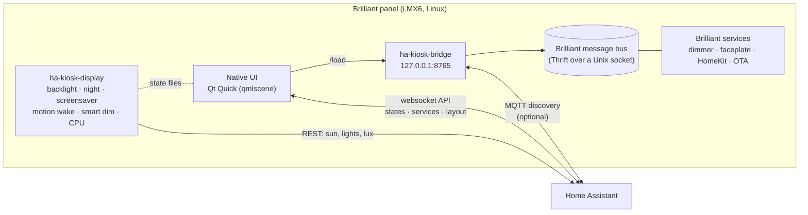

# Brilliant → Home Assistant Panel

**Turn a Brilliant smart-home control into a fast, dark, native Home Assistant wall panel, while
it keeps working as a light switch.**

[](https://github.com/MikeI-Code/brilliant-ha-kiosk/releases/latest)
[](https://github.com/MikeI-Code/brilliant-ha-kiosk/releases?q=nightly&expanded=true)
[](CHANGELOG.md)

<p align="center">
  
  
  
  
  
</p>
<p align="center">
  
  
  
  
</p>
<p align="center"><sub>Second row: Security (camera pictures blanked for this screenshot), Capture, the screensaver with local weather, and two-finger dimming.</sub></p>

Brilliant panels are great hardware: a 720×1280 touchscreen, a dimmer, Wi-Fi, a speaker and
microphones in a light-switch box. This project replaces the stock touchscreen app with a
**native Qt Quick interface that talks to Home Assistant directly**. It keeps Brilliant's own
background services, so the wired light, HomeKit and over-the-air updates keep working.

Nothing is hacked or jail-broken. SSH access is a built-in feature of the panel's software that
you switch on, and everything this project installs lives in `/etc` and `/var`, which survive
Brilliant's OS updates. One script undoes it all.

---

## Why build on Brilliant hardware

There are cheaper ways to put a touchscreen on a wall: an ESP32 display, an old tablet. This
project deliberately builds on Brilliant panels, and I think the hardware and the team behind it
are worth supporting. *I'm not an employee of Brilliant or otherwise tied to the company; this is
a user's view.*

**What a Brilliant panel brings that a generic ESP32 panel can't:**

* **Integrations Home Assistant doesn't have.** Brilliant's own software links to Ring (doorbells,
  cameras and the **Ring Alarm**) and Schlage locks through each company's account linking, and
  keeps those links working. Home Assistant's Ring integration has no Ring Alarm support (at the
  time of writing); on a Brilliant panel this project shows the alarm and arms or disarms it, by
  using Brilliant's integration, which you link in the Brilliant app. Schlage locks work the same
  way, through Brilliant's own link.
* **An engineering team and back-end services.** Account linking, token refresh, cloud services
  and firmware updates are maintained by people whose job it is, not by you on a weekend.
* **Hardware made for the wall box.** A line-voltage dimmer that reports power and temperature, a
  microphone array, a speaker, a camera and motion sensing, in the space of a light switch.
* **Support for real devices.** When a vendor changes an API or a login flow, it's Brilliant's
  team that adapts. This project keeps using their services instead of re-implementing them.

A generic ESP32 panel is a great way to tinker, but you become the integration team, the back end
and the support desk. If this project is useful to you, support Brilliant: buy their panels and
plugs, keep your Brilliant account and integrations linked, and leave their services running.
That's why this project only replaces the screen and never removes Brilliant's background services.

---

## Features

| | |
|---|---|
| ⚡ **Native and fast** | Qt Quick on the GPU, talking to HA's websocket API. Instant taps, smooth scrolling and swiping, about 350 MB of RAM to spare. |
| 🏠 **Ready-made tabs** | Home (clock, weather, 5-day forecast, scenes, key lights, thermostats, now playing), Lights, Climate, Music, House, plus **Security** when Brilliant reports Ring or Schlage devices. Swipe or tap to switch. |
| ✏️ **Edit screens in Home Assistant** | Lay out the panel in HA's own drag-and-drop dashboard editor. Every panel rebuilds within a second of pressing **Save**. |
| 🎨 **Same look in Home Assistant** | A matching HA theme (`ha/themes/brilliant-kiosk.yaml`) gives HA's web interface and phone app the panel's colours. |
| 💡 **Local control of the wired light** | The panel dims its own load directly over Brilliant's message bus, in about 0.1 s, even if Home Assistant is down. |
| ✌️ **Multi-touch gestures** | Two fingers up/down dim the room light, a two-finger tap toggles it, three fingers up/down set the room's speaker volume, plus your own custom gestures. |
| 🎵 **One music screen for any player** | Works with whatever music integration Home Assistant has: Sonos, WiiM/LinkPlay, Music Assistant, Bluesound, Google Cast, Spotify and more. Room picker, album art, transport, volume, sources, grouping with a volume per speaker, and the player's favorites or library as tap-to-play tiles. Buttons the player doesn't support are hidden. |
| 🌙 **Night mode, screensaver, motion wake** | Screen off overnight, a photo slideshow with a clock when idle (your photos from a folder or uploaded in Home Assistant), and it wakes when you walk up. |
| 📡 **Shows up in Home Assistant** | Optional MQTT discovery: each panel becomes an HA device with its wired light, power, motion, display state, screensaver/night switches, and gestures as automation triggers. |
| 🔆 **Smart dimming** | Brightness follows the room: from an HA light sensor if you have one, otherwise from the sun and the room's lights. |
| 🎙️ **Home Assistant voice satellite** | Optional (`KIOSK_VOICE=1`): the panel's mic and speaker become an Assist satellite over the Wyoming protocol. Add it with HA's built-in Wyoming integration; push-to-talk or HA wake word, plus announcements. No extra packages on the panel. ([Voice](docs/MANUAL.md#29-voice-assistant-and-announcements-optional-off-by-default)) |
| 🔔 **Doorbell pop-up** | Ring doorbells (through Brilliant's own Ring link) wake the panel and show that door's camera full-screen. Camera cards from HA dashboards work as tiles too. |
| 📹 **Live camera video** | H.264 cameras play live in the full-screen view on the panel's hardware video decoder; others show refreshed stills. Pinch to zoom, drag to pan, double-tap to reset. ([Cameras](docs/MANUAL.md#3-using-the-panel)) |
| 🛡️ **Ring Alarm and Schlage locks** | Alarm status on the Home screen, arm / disarm with your code, and lock / unlock (two taps to unlock), through Brilliant's integrations. Home Assistant gets read-only status. If a Brilliant update changes something, only the affected control switches off, with the reason on the panel and in HA. ([How this works](docs/MANUAL.md#how-the-alarm-and-lock-control-works)) |
| 🏢 **Multi-unit ready (lite groups)** | For duplexes and rentals: group panels by unit with shared settings, keep the intercom inside the unit, limit each panel to its own doors and locks (or view only), and lock the mic or camera where needed. ([How it works and what it doesn't isolate](docs/MANUAL.md#213-multi-unit-and-rental-properties-lite-groups)) |
| 🔒 **Private by design** | Your HA token, passwords and layout live in a git-ignored `.private/` folder. The local bridge listens on localhost only. |
| 🧩 **Manage panels from Home Assistant** | The **Brilliant Kiosk** integration installs, updates and rolls back the kiosk, shows each panel's health, and changes its settings, all from Home Assistant. Install it from the Marketplace: [MikeI-Code/ha-brilliant-kiosk](https://github.com/MikeI-Code/ha-brilliant-kiosk). |


---

## Releases

There are two release channels. Both ship the same kind of checksummed install bundle.

| Channel | Where | What it is |
| --- | --- | --- |
| **Stable** | [Latest release](https://github.com/MikeI-Code/brilliant-ha-kiosk/releases/latest) · tags `vX.Y.Z` | Tested releases. Use this unless you want to try new features early. |
| **Nightly** | [Nightly prereleases](https://github.com/MikeI-Code/brilliant-ha-kiosk/releases?q=nightly&expanded=true) · branch [`nightly`](https://github.com/MikeI-Code/brilliant-ha-kiosk/tree/nightly) | Built each night when the `nightly` branch changed. New work, including integrations with other services, lands here first. May have rough edges. |

What changed, and what is waiting on the nightly channel: [**CHANGELOG.md**](CHANGELOG.md).

To install a channel, check it out before running the installer below: `git checkout v1.4.0`
(or the newest `vX.Y.Z`) for stable, `git checkout nightly && git pull` for nightly.
Going back is the same `scripts/install.sh` from the other checkout.

## Quick start

> Full step-by-step instructions, every setting, and troubleshooting are in the
> **[Manual](docs/MANUAL.md)**.

**You need:** a Brilliant Control on your Wi-Fi, a Home Assistant install on the same network, and
a computer with `bash` (Linux, macOS, or Git Bash on Windows) plus `ssh` or PuTTY's `plink`.

1. **Turn on SSH on the panel.** Brilliant's software has an official **Root SSH Login** setting
   under *Advanced Settings* (see the [manual](docs/MANUAL.md#21-turn-on-ssh-on-the-panel) for its
   caveats). No exploit is needed. Note the panel's IP address and the root password it gives you.
2. **Clone this repo** and create your private config:
   ```bash
   git clone https://github.com/MikeI-Code/brilliant-ha-kiosk.git
   cd brilliant-ha-kiosk
   mkdir -p .private
   cp config/kiosk.env.example  .private/kiosk.env     # settings for ALL panels: HA address, features
   cp config/panel.env.example  .private/panel1.env    # how to reach panel1: IP + root password
   ```
   Add `.private/panel2.env`, `panel3.env`, ... for more panels (address only). If one panel needs
   different settings, add `.private/panel2.kiosk.env` with just those lines (see
   `config/panel.kiosk.env.example`); without it, the panel uses `kiosk.env` as is.
3. **Create a Home Assistant token** (your profile → *Security* → *Long-lived access tokens*) and
   save it as `.private/token`.
4. **Install:**
   ```bash
   scripts/install.sh panel1     # one panel
   scripts/install.sh all        # every panel in .private/ (panel1.env, panel2.env, ...)
   ```
   The panel restarts its screen into the new interface (about 30 s).
5. **Design the screens in Home Assistant.** In HA go to *Settings → Dashboards → Add dashboard*,
   choose *New dashboard from scratch* and give it the URL **`panel-layout`**. Add cards in HA's
   editor; every panel rebuilds within a second of pressing **Save**. Each view becomes a tab.
   *(Optional: `scripts/publish_layout.py native/layout.example.json` fills a new dashboard with a
   starter layout to edit, instead of starting empty.)*

**Many panels, one setup.** All panels share `.private/kiosk.env` and the same HA dashboard, so
ten panels need no more configuration than one:

| File | Per | Holds |
|---|---|---|
| `.private/kiosk.env` | all panels | the settings |
| `.private/panelN.env` | panel (required) | only how to reach it: IP and password |
| `.private/panelN.kiosk.env` | panel (optional) | only what differs for that panel: its wired light, room speakers, or a feature turned on or off just there |

`scripts/install.sh all` upgrades every panel and re-applies these settings. It never changes your
files in `.private/`, and per-panel features are kept because they live in `panelN.kiosk.env`; only
edits made by hand on a panel are replaced. Choices made from HA switches (screensaver, night mode,
...) are kept too.

Every install checks itself: if the new version doesn't come up and connect to Home Assistant
within a minute, the panel goes back to the previous version on its own.

To go back to the stock Brilliant interface at any time: `scripts/uninstall.sh panel1`.

---

## How it works



* The stock touchscreen app (`switch_ui_app`) is disabled. Everything else Brilliant runs keeps
  running.
* `ha-kiosk.service` runs the UI (`native/main.qml`) on the GPU. Its layout comes from an HA
  dashboard (or a local `layout.json`) and is cached on the panel for offline boots.
* `ha-kiosk-display` owns the screen: backlight, night schedule, screensaver, motion wake, smart
  dimming and the CPU governor. A small systemd drop-in stops Brilliant's own screen-off logic from
  fighting it.
* `ha-kiosk-bridge` talks to Brilliant's message bus, so the screen can control the wired load
  directly. With MQTT configured, it also publishes the panel to Home Assistant as a device. The bus protocol is documented in
  [docs/hardware-and-services.md](docs/hardware-and-services.md).

---

## Home Assistant integration

The **Brilliant Kiosk** integration manages your panels from Home Assistant: kiosk version and
service health, updates and rollback (stable and nightly channels), settings, restarts, redacted
logs, Brilliant message-bus variables and repair notices. Each panel appears as a device named
after its room, linked to the device the kiosk already publishes over MQTT.

1. **Home Assistant 2026.11 or newer:** **Settings → Marketplace → Add from link**, enter
   `MikeI-Code/ha-brilliant-kiosk`, install, and restart when asked. Older versions: add the same
   repository to HACS as a custom repository of type *Integration*. (Don't add this repository,
   `brilliant-ha-kiosk`, to HACS or the Marketplace: its releases are panel software.)
2. **Settings → Devices & services → Add integration → Brilliant Kiosk**, enter the panel's
   address and SSH password, and confirm its SSH host key.

New versions then appear in **Settings → Updates**. Full documentation, with every entity, action
and troubleshooting step: **[github.com/MikeI-Code/ha-brilliant-kiosk](https://github.com/MikeI-Code/ha-brilliant-kiosk)**.

---

## Documentation

| | |
|---|---|
| 📝 [**Changelog**](CHANGELOG.md) | Every release, and what is on the nightly channel |
| 🏠 [**Home Assistant integration**](https://github.com/MikeI-Code/ha-brilliant-kiosk) | Manage panels from Home Assistant: install, updates, health, settings, logs, troubleshooting |
| 📘 [**Manual**](docs/MANUAL.md) | Installation, configuration reference, editing screens, gestures, maintenance, troubleshooting |
| 🔧 [Hardware & services](docs/hardware-and-services.md) | Hardware, kernel interfaces, Brilliant's services, and the message-bus API |
| 📊 [Resources & optimizations](docs/resource-utilization-and-optimizations.md) | Memory and CPU measurements, what is safe to change |
| 🔍 [Device survey](docs/device-survey.md) | Original OS and hardware survey |

## Repository layout

```
native/        Native UI (Qt Quick): main.qml, tiles, Music and Security pages, gestures, HA client
kiosk/         On-panel services: display manager, local bridge, smart dimming, swap, web-mode UI
systemd/       Units and drop-ins installed on the panel
scripts/       install / uninstall / logs, plus publishing layouts to Home Assistant
tools/         Message-bus CLI, touch injector for testing, icon map generator
config/        Example settings (copy into .private/)
docs/          Manual, hardware and service notes, screenshots
```

## Compatibility

Tested on Brilliant Control panels (single-gang, no physical slider) running Brilliant OS
**v26.10.21.1** (Yocto kirkstone, kernel 5.15) with **Home Assistant 2026.10**. Other Brilliant
models and firmware versions may differ; see the manual's troubleshooting section.

## Credits

Created by **Mike Ippolito** ([@MikeI-Code](https://github.com/MikeI-Code)).

Icons: [Material Design Icons](https://pictogrammers.com/library/mdi/) by Pictogrammers.
See also [brilliant-mqtt](https://github.com/joyfulhouse/brilliant-mqtt), a separate community
project that bridges Brilliant panels to Home Assistant over MQTT.

## License

[Apache License 2.0](LICENSE) © 2026 Mike Ippolito. Releases before v1.3.0 were published under the MIT License (see [`NOTICE`](NOTICE)). Third-party components keep their own licenses (see `NOTICE`).

*Brilliant is a trademark of its respective owner. This is an independent community project, not
affiliated with or endorsed by Brilliant or the Home Assistant project. Use at your own risk: it
changes how a mains-wired device behaves, so keep the stock UI one `uninstall.sh` away.*

[](https://buymeacoffee.com/mikeimb)
>
