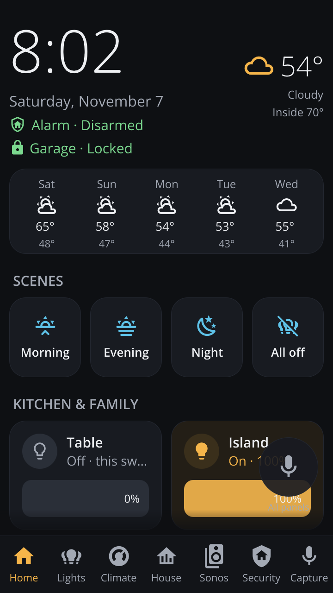
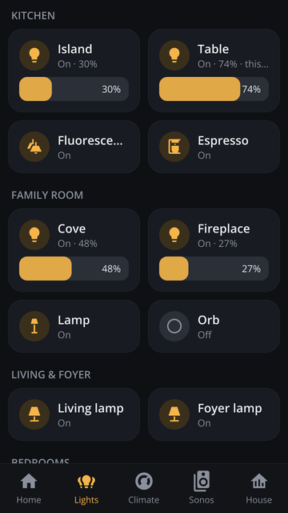
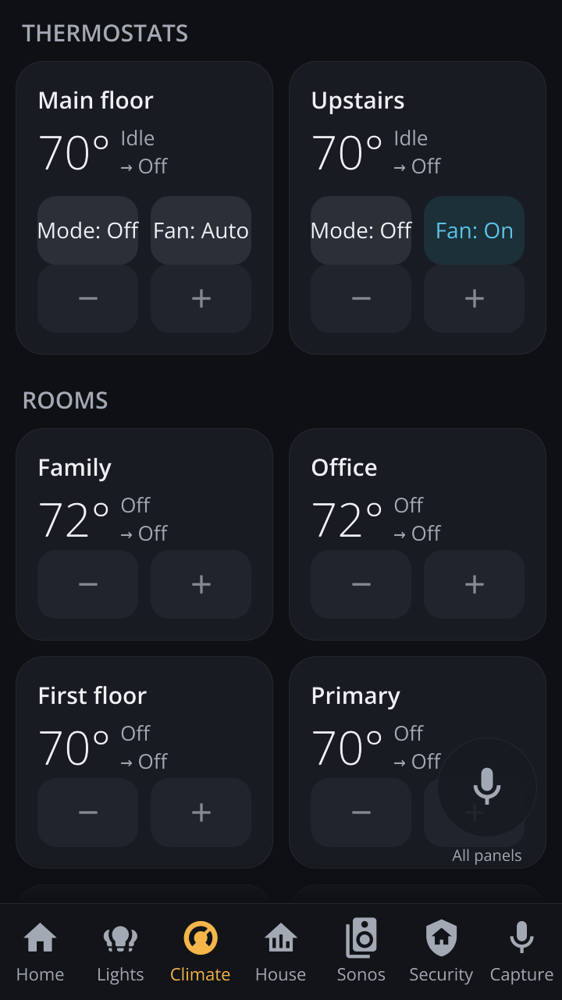
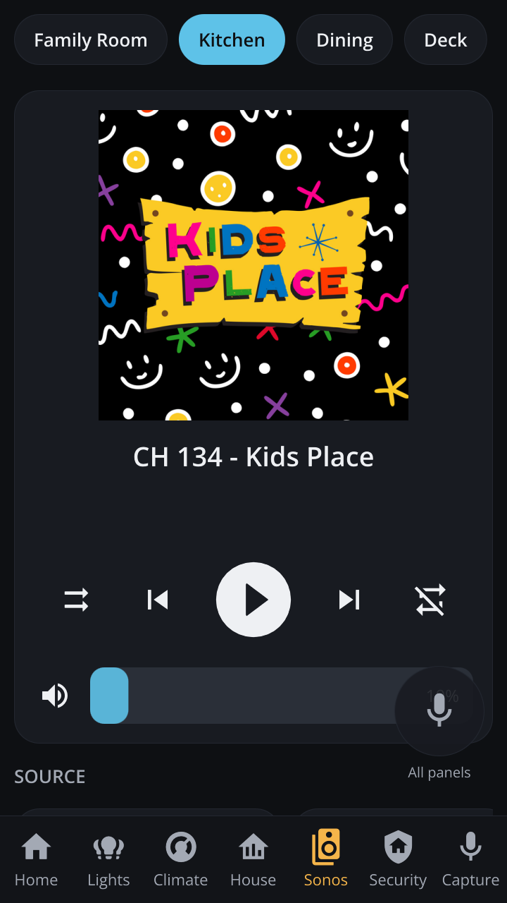
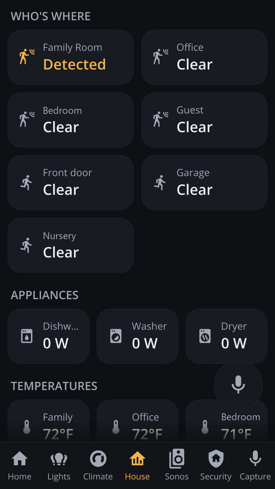
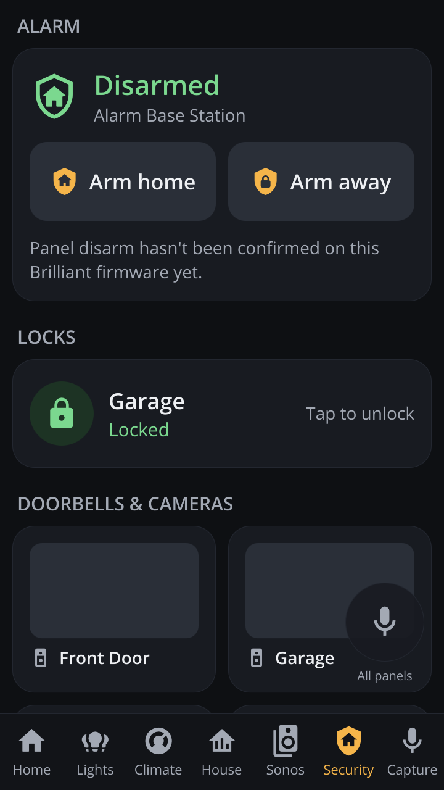
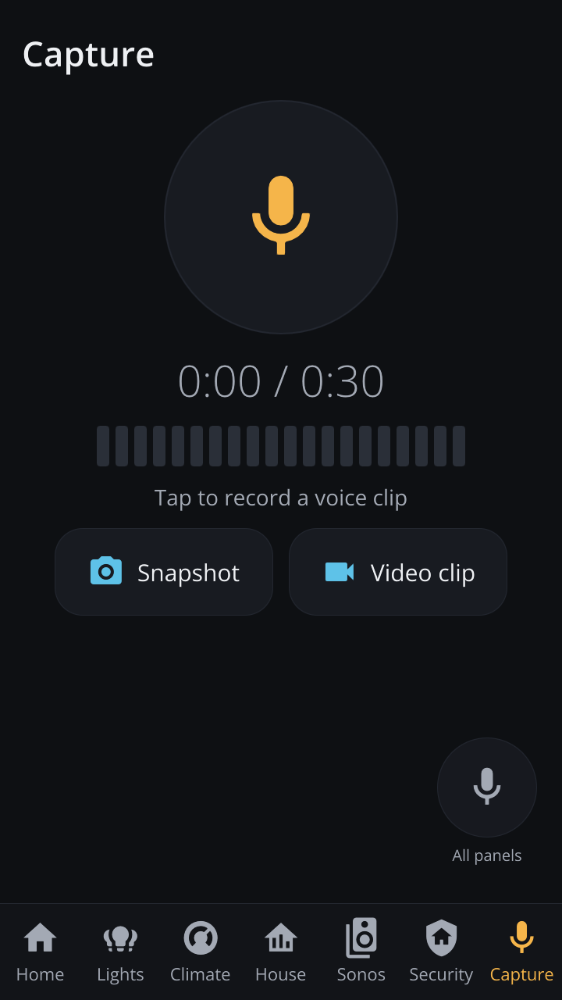
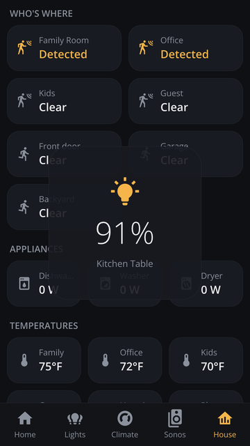
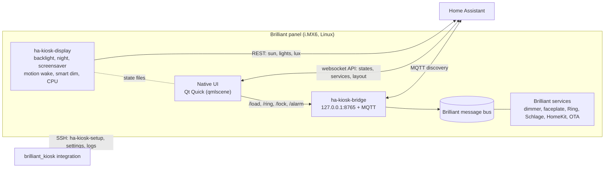

# Brilliant HA Kiosk

A native Home Assistant interface for Brilliant smart-home panels. The kiosk replaces the
panel's stock touchscreen app with a fast Qt Quick UI that talks to Home Assistant directly,
while the panel keeps working as a light switch and Brilliant's own services keep running.

[](https://github.com/MikeI-Code/brilliant-ha-kiosk/releases/latest)
[](https://github.com/MikeI-Code/brilliant-ha-kiosk/releases?q=nightly&expanded=true)
[](CHANGELOG.md)

<p align="center">
  
  
  
  
  
</p>
<p align="center">
  
  
  
  
</p>

## What is in this repository

| Part | Where | What it is |
|---|---|---|
| **Kiosk** | `native/`, `kiosk/`, `systemd/`, `scripts/` | The panel software: the UI, the display, bridge, voice, intercom and capture services, the on-panel installer `ha-kiosk-setup`, and the scripts that install it from your computer. Documented in the [Manual](docs/MANUAL.md). |
| **Home Assistant integration** | `custom_components/brilliant_kiosk/` | `brilliant_kiosk` 0.2.0: manages panels from Home Assistant over SSH (install, update, roll back, health, settings, logs, repairs). Distributed from [MikeI-Code/ha-brilliant-kiosk](https://github.com/MikeI-Code/ha-brilliant-kiosk). Documented in [docs/home-assistant-integration.md](docs/home-assistant-integration.md). |
| **Library** | `lib/pybrilliantkiosk/` | [`pybrilliantkiosk`](https://pypi.org/project/pybrilliantkiosk/) 0.1.3: the typed async Python client the integration uses to talk to panels. [README](lib/pybrilliantkiosk/README.md). |

## What the kiosk does

* **Native UI** on the panel's GPU: tabs for Home (clock, weather, forecast, scenes, lights,
  thermostats, now playing), Lights, Climate, Music, House, and a Security tab when Brilliant
  reports Ring or Schlage devices. Screens are laid out in Home Assistant's dashboard editor and
  every panel rebuilds within a second of saving.
* **Local control of the wired light** over Brilliant's message bus, with two-finger dimming and
  other multi-touch gestures. Works when Home Assistant is down.
* **Display management**: night schedule, photo screensaver (photos from a folder or uploaded in
  Home Assistant), motion wake, smart dimming from a light sensor or the sun and room lights.
* **Home Assistant device over MQTT**: wired light, power, temperatures, motion, display state,
  screensaver and night switches, gestures as events, and more.
* **Optional services**, each off by default: a Wyoming voice satellite for Assist, an audio
  intercom between panels, and a capture screen for voice clips, snapshots and short videos.
* **Ring Alarm, Schlage locks, Ring doorbells and cameras** through the integrations you link in
  the Brilliant app, with a doorbell pop-up and live H.264 camera video.
* **Multi-unit support**: group panels per unit, limit each to its own doors and locks, and lock
  the microphone or camera where needed.

Nothing is jail-broken. SSH is a feature of Brilliant's software that you switch on. Everything
the kiosk installs lives in `/etc` and `/var`, and one command restores the stock screen.

## Releases

| Channel | Where | What it is |
|---|---|---|
| **Stable** | [Latest release](https://github.com/MikeI-Code/brilliant-ha-kiosk/releases/latest), tags `vX.Y.Z` (current: **v1.4.0**) | Tested releases. Use this unless you want new features early. |
| **Nightly** | [Prereleases](https://github.com/MikeI-Code/brilliant-ha-kiosk/releases?q=nightly&expanded=true) `nightly-YYYYMMDD`, built from the [`nightly`](https://github.com/MikeI-Code/brilliant-ha-kiosk/tree/nightly) branch | Built when the branch changed. New work lands here first and may have rough edges. |

Both channels ship the same kind of bundle, `brilliant-ha-kiosk-<version>.tar.gz` with a
`.sha256` file. A nightly bundle's version looks like `v1.4.0-nightly.20261108.g89ec239`. What
changed is in [CHANGELOG.md](CHANGELOG.md).

To install from a checkout, pick the channel first: `git checkout v1.4.0` for stable, or
`git checkout nightly && git pull` for nightly. Then run `scripts/install.sh` as below.

## Quick start

Full instructions, every setting and troubleshooting are in the **[Manual](docs/MANUAL.md)**.

You need a Brilliant Control on your Wi-Fi, Home Assistant on the same network, and a computer
with `bash` (Linux, macOS, or Git Bash on Windows) and `ssh` or PuTTY's `plink`.

1. **Turn on SSH on the panel.** Brilliant's software has a **Root SSH Login** setting under
   *Advanced Settings*. Note the panel's IP address and the root password it shows
   ([details and caveats](docs/MANUAL.md#21-turn-on-ssh-on-the-panel)).
2. **Clone this repository and create your private config:**
   ```bash
   git clone https://github.com/MikeI-Code/brilliant-ha-kiosk.git
   cd brilliant-ha-kiosk
   git checkout v1.4.0                                   # or: git checkout nightly
   mkdir -p .private
   cp config/kiosk.env.example .private/kiosk.env       # settings for all panels
   cp config/panel.env.example .private/panel1.env      # how to reach panel1: address and password
   ```
   Edit `.private/panel1.env` (panel address, root password) and `.private/kiosk.env` (at least
   `HA_URL`, Home Assistant's LAN address).
3. **Create a Home Assistant token** (your profile, *Security*, *Long-lived access tokens*) with
   an administrator account and save it as one line in `.private/token`.
4. **Install:**
   ```bash
   scripts/install.sh panel1     # one panel
   scripts/install.sh all        # every .private/<panel>.env
   ```
   After about 30 seconds the panel shows the new interface. If the new version does not come up
   and connect to Home Assistant within a minute, the panel rolls back on its own.
5. **Design the screens in Home Assistant.** Create a dashboard with the URL `panel-layout`
   (*Settings*, *Dashboards*, *Add dashboard*, *New dashboard from scratch*) and add cards. Each
   view becomes a tab. `scripts/publish_layout.py native/layout.example.json` fills it with a
   starter layout.

To go back to the stock interface: `scripts/uninstall.sh panel1`.

## Home Assistant integration

The `brilliant_kiosk` integration manages panels from Home Assistant: it installs, updates and
rolls back the kiosk, shows health and install state, edits settings, reads redacted logs and
Brilliant message-bus variables, and raises repair issues when settings drift. The panel's
*entities* (wired light, motion, switches) come from the kiosk's MQTT publishing; the
integration adds the admin layer on top.

* Home Assistant 2026.11 or newer: **Settings, Marketplace, Add from link**, enter
  `MikeI-Code/ha-brilliant-kiosk`, install, restart.
* Older Home Assistant (2026.3.1 to 2026.10): add `https://github.com/MikeI-Code/ha-brilliant-kiosk`
  as a HACS custom repository of type *Integration*.
* Then **Settings, Devices & services, Add integration, Brilliant Kiosk**. Panels running a
  current kiosk nightly are discovered over MQTT with their address filled in.

Documentation: [docs/home-assistant-integration.md](docs/home-assistant-integration.md).

## How it works



* The stock touchscreen app (`switch_ui_app`) is disabled; every other Brilliant service keeps
  running.
* `ha-kiosk.service` runs the UI (`native/main.qml`). Its layout comes from a Home Assistant
  dashboard (or a local `layout.json`) and is cached on the panel for offline boots.
* `ha-kiosk-display` owns the backlight, night schedule, screensaver, motion wake, smart dimming
  and CPU governor. A systemd drop-in keeps Brilliant's own screen-off logic out of the way.
* `ha-kiosk-bridge` talks to Brilliant's message bus for the wired load, Ring and Schlage, and
  publishes the panel to Home Assistant over MQTT.
* `ha-kiosk-setup` (on the panel, `/var/lib/ha-kiosk/ha-kiosk-setup`) installs releases, keeps
  the previous one, rolls back on failure and reports JSON status. `scripts/install.sh` and the
  integration both use it.

The bus protocol is documented in [docs/hardware-and-services.md](docs/hardware-and-services.md).

## Documentation

| Document | Contents |
|---|---|
| [Manual](docs/MANUAL.md) | Install, every setting, features, release channels, maintenance, troubleshooting, uninstall |
| [Home Assistant integration](docs/home-assistant-integration.md) | Install, configuration, actions, entities, polling, limitations, troubleshooting |
| [pybrilliantkiosk](lib/pybrilliantkiosk/README.md) | The Python library |
| [Changelog](CHANGELOG.md) | Every release and what is on the nightly channel |
| [INTEGRATION.md](docs/INTEGRATION.md) | `ha-kiosk-setup` commands, exit codes and MQTT topics for tool authors |
| [Hardware and services](docs/hardware-and-services.md) | Hardware, kernel interfaces, Brilliant's services, the message-bus API |
| [Resources and optimizations](docs/resource-utilization-and-optimizations.md) | Memory and CPU measurements |
| [Device survey](docs/device-survey.md) | Original OS and hardware survey |
| [Admin helper spec](docs/admin-helper-spec.md) | Design of the library and integration |

## Repository layout

```
native/              Native UI (Qt Quick): main.qml, tiles, pages, gestures, HA client
kiosk/               On-panel services and installers: display, bridge, MQTT, voice, intercom,
                     capture, photos, ha-kiosk-setup, install-local.sh
systemd/             Units and drop-ins installed on the panel
scripts/             install.sh, uninstall.sh, logs.sh, build-bundle.sh, publish_layout.py
config/              Example settings files (copy into .private/)
custom_components/   Home Assistant integration brilliant_kiosk
lib/pybrilliantkiosk Python library
tools/               Message-bus CLI, touch injector, icon map generator
docs/                Manual, integration docs, hardware notes, screenshots
tests/               Integration and library tests
```

## Compatibility

Tested on Brilliant Control panels (single-gang, no physical slider) running Brilliant OS
v26.10.21.1 (Yocto kirkstone, kernel 5.15) with Home Assistant 2026.10 and 2026.11. Other
Brilliant models and firmware versions may differ; see the
[manual's troubleshooting section](docs/MANUAL.md#9-troubleshooting).

## Credits and license

Created by Mike Ippolito ([@MikeI-Code](https://github.com/MikeI-Code)). Icons:
[Material Design Icons](https://pictogrammers.com/library/mdi/) by Pictogrammers. See also
[brilliant-mqtt](https://github.com/joyfulhouse/brilliant-mqtt), a separate community project
that bridges Brilliant panels to Home Assistant over MQTT; the kiosk can publish alongside it
(`KIOSK_MQTT=kiosk`).

[Apache License 2.0](LICENSE), 2026 Mike Ippolito. Releases before v1.3.0 were published under
the MIT License (see [`NOTICE`](NOTICE)). Third-party components keep their own licenses.

Brilliant is a trademark of its respective owner. This is an independent community project, not
affiliated with or endorsed by Brilliant or the Home Assistant project. It changes how a
mains-wired device behaves; keep the stock UI one `scripts/uninstall.sh` away.

[](https://buymeacoffee.com/mikeimb)
