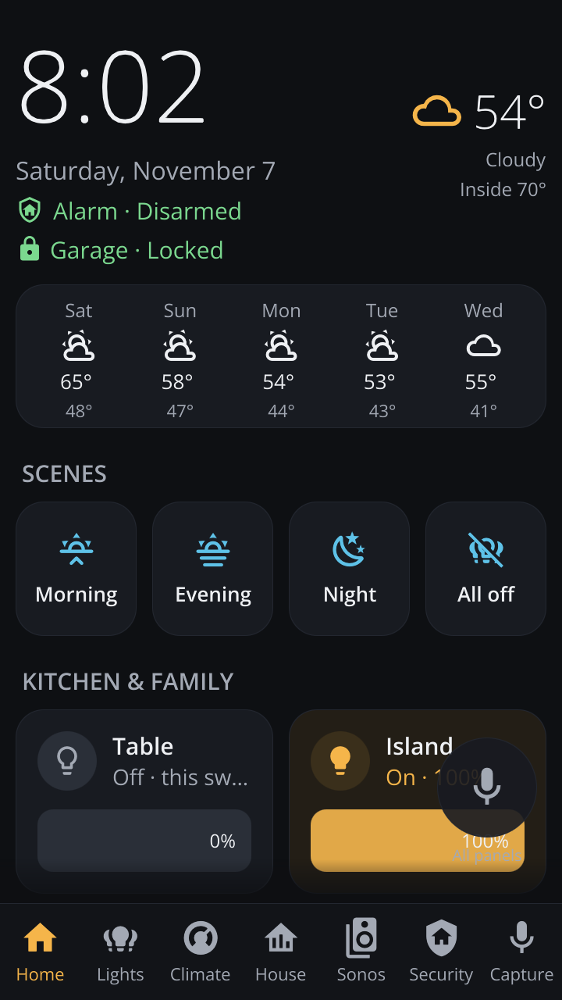
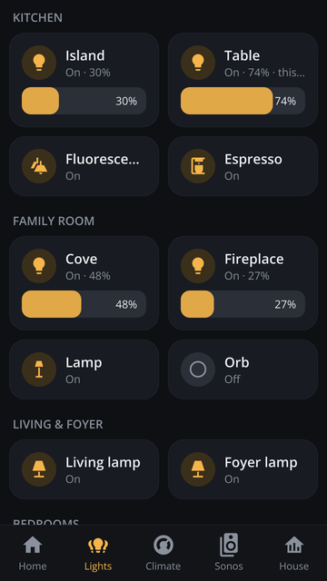
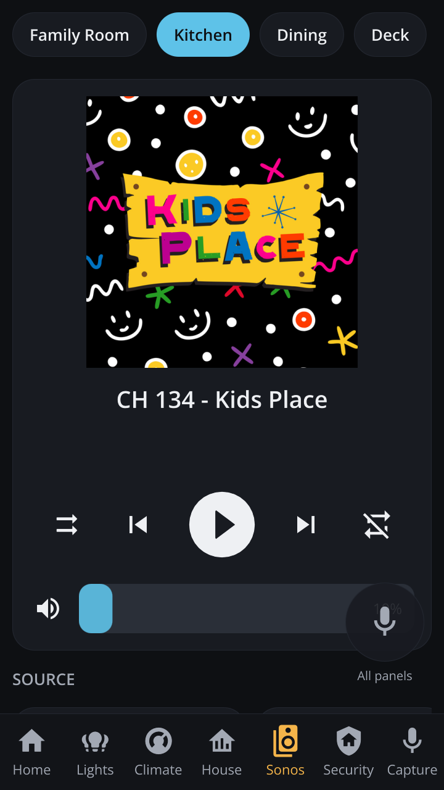
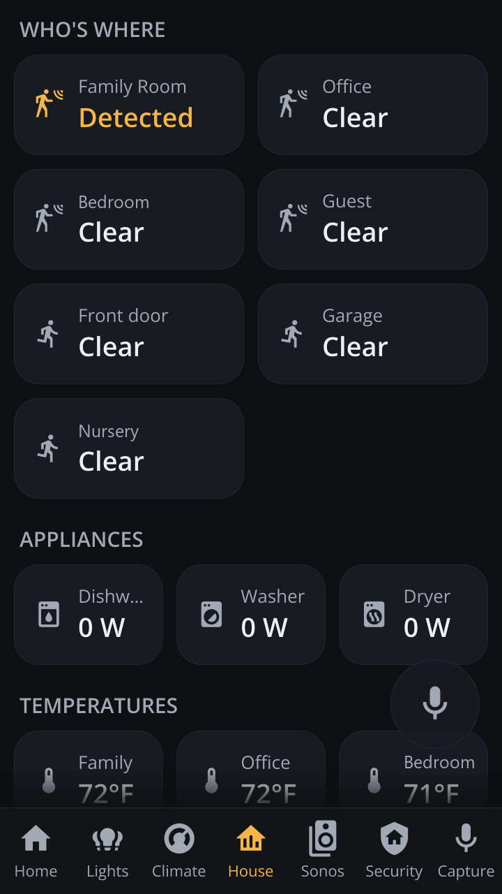
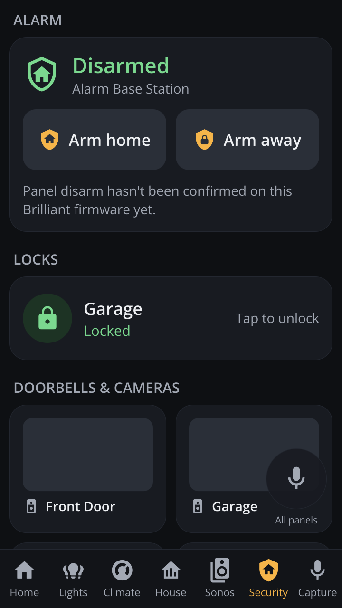
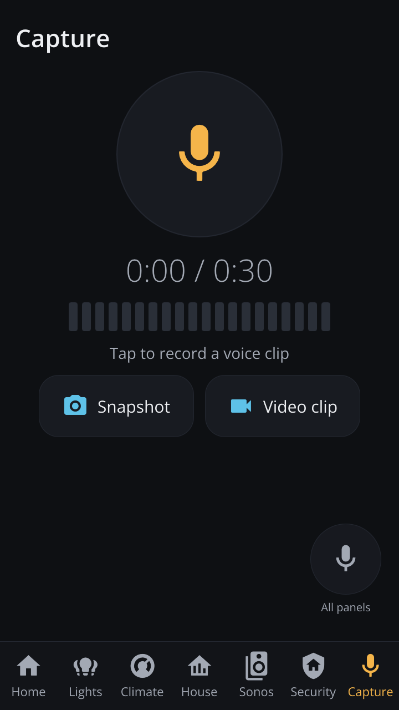
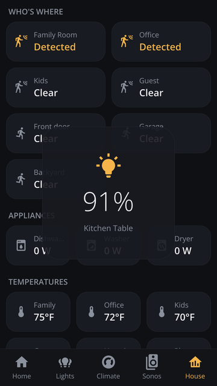

# Manual

Everything you need to install, configure, use and maintain the Brilliant → Home Assistant panel.

> **Why Brilliant hardware?** Brilliant's own software keeps integrations working that Home Assistant
> doesn't have, such as the Ring Alarm (and maintains others, such as Schlage locks), backed by an engineering team and cloud
> services. This project only replaces the screen and keeps all of Brilliant's background services, so
> keep your Brilliant account and integrations linked in the Brilliant app. See the README for more.

**Contents**

1. [Requirements](#1-requirements)
2. [Installation](#2-installation)
3. [Using the panel](#3-using-the-panel)
4. [Editing the screens in Home Assistant](#4-editing-the-screens-in-home-assistant)
5. [This switch: local control and gestures](#5-this-switch-local-control-and-gestures)
6. [Display: night mode, screensaver, motion wake, smart dimming](#6-display-night-mode-screensaver-motion-wake-smart-dimming)
7. [Configuration reference](#7-configuration-reference)
8. [Maintenance](#8-maintenance)
9. [Troubleshooting](#9-troubleshooting)
10. [Tools for tinkerers](#10-tools-for-tinkerers)

Related documents: the [Home Assistant integration](home-assistant-integration.md) (manage
panels from Home Assistant), [INTEGRATION.md](INTEGRATION.md) (the `ha-kiosk-setup` contract for
tool authors), [hardware-and-services.md](hardware-and-services.md) (the panel's hardware and
message bus).

---

## 1. Requirements

| What | Notes |
|---|---|
| **Brilliant Control panel** | Tested on single-gang panels without a physical slider, Brilliant OS v26.10.21.1. The panel must be on your Wi-Fi. |
| **Home Assistant** | Reachable from the panel on your **local network** (the panel can't use Tailscale/VPN addresses). Tested with HA 2026.10 and 2026.11. Sonos, weather and your lights should already be set up in HA. |
| **A computer** to install from | `bash` (Linux, macOS, or Git Bash on Windows) and either OpenSSH (`ssh`) or PuTTY's `plink`. `plink` is used automatically when a password is configured. |
| **Python 3** (optional) | Only for `scripts/publish_layout.py` (creating the editable layout in HA): `pip install websockets`. |
| **An MQTT broker** (recommended) | For the panel's Home Assistant device, the intercom, capture events and the Home Assistant integration. The Mosquitto add-on is enough (section 2.7). |

Nothing needs to be installed on the panel itself: it already has Qt 5.15, QtWebSockets and Python.

---

## 2. Installation

### 2.1 Turn on SSH on the panel

Brilliant's software has an official **Root SSH Login** setting, found in the panel's
**Advanced Settings**, so nothing is hacked or exploited. According to Brilliant's support pages:

* Turning it on requires **verifying your identity by email**.
* It is **permanent**: the panel is flagged from then on, and *Device Settings* shows a
  "May Have Had Root SSH Enabled" security status. Brilliant warns that it can affect software
  updates and that it no longer guarantees the software's integrity.
* **Brilliant will never ask you to enable it or for your credentials.** Treat any such request as
  a scam.

See Brilliant's articles [Root SSH](https://support.brilliant.tech/hc/en-us/articles/23152790775195-RootSSH)
and [Security Status on Device Settings](https://support.brilliant.tech/hc/en-us/articles/21213665069851-Security-Status-on-Device-Settings).
The option may not be offered on every panel or firmware version. If you don't see it, check those
articles or contact Brilliant support.

Write down:

* the panel's **IP address** (give it a fixed lease in your router, so it doesn't change), and
* the **root password** it shows.

Check from your computer:

```bash
ssh root@<panel-ip>          # or: plink -ssh root@<panel-ip>
```

The first connection shows the panel's **host-key fingerprint** (`SHA256:…`). Note it: pinning it
in the config protects against a spoofed device on your network.

### 2.2 Get the code and create your private config

```bash
git clone https://github.com/MikeI-Code/brilliant-ha-kiosk.git
cd brilliant-ha-kiosk
git checkout v1.4.0            # stable; or: git checkout nightly   (see section 8, Release channels)
mkdir -p .private
```

Everything specific to your home goes in **`.private/`**. It is git-ignored, so it never ends up in
a commit:

| File | Needed? | What it's for |
|---|---|---|
| `.private/kiosk.env` | **Yes, one** | **Settings for every panel**: Home Assistant address, schedule, features (see [§7](#7-configuration-reference)). Start from `config/kiosk.env.example`. |
| `.private/panel1.env`, `panel2.env`, ... | **Yes, one per panel** | **How to reach that panel** and nothing else: `PANEL_HOST`, `PANEL_USER` (default `root`), `PANEL_PASSWORD`, `PANEL_HOSTKEY`. Start from `config/panel.env.example`. The file name is the panel's name for the scripts (`panel1`). |
| `.private/panel1.kiosk.env`, ... | Optional | **Settings for that panel only**, when it needs something different: its wired light (`LOAD_ENTITY`), room speakers and lights, or a feature turned on or off just here (e.g. `KIOSK_VOICE=1`, `DOORBELL=0`). Start from `config/panel.kiosk.env.example`. **Without it, the panel uses `kiosk.env` as is.** |
| `.private/<group>.group.env` | Optional | Settings for a group of panels, e.g. one apartment (see [§2.13](#213-multi-unit-and-rental-properties-lite-groups)). |
| `.private/token` | Yes | A Home Assistant long-lived access token (below). |
| `.private/layout.json` | Optional | A local layout, used only when you don't design the screens in HA. |
| `.private/photos/` | Optional | Screensaver photos (JPEG/PNG), copied to every panel. |

**How each panel's settings are built:** `kiosk.env`, then the panel's group file (if it has one),
then the panel's own `.kiosk.env` (if it has one). Later lines win, so a panel file only needs the
lines that differ. Turning a shared feature off for one panel is just `FEATURE=0` in its file. The combined file is
validated by `ha-kiosk-setup` on the panel: an unknown key or a value with `"`, `'`, `` ` ``, `$`, `\`
or a control character is rejected and nothing is installed.

```bash
cp config/panel.env.example .private/panel1.env
cp config/kiosk.env.example .private/kiosk.env
```

Edit `.private/panel1.env`:

```bash
PANEL_HOST=192.168.1.50
PANEL_USER=root
PANEL_PASSWORD=<root password from the panel>
PANEL_HOSTKEY=SHA256:<fingerprint from 2.1>
```

Edit `.private/kiosk.env`. At minimum set **`HA_URL`** to Home Assistant's **LAN** address:

```bash
HA_URL=http://192.168.1.10:8123
TZ=EST5EDT,M3.2.0,M11.1.0      # the panel's clock runs in UTC; this is US Eastern
TZ_LOCAL=EST5EDT,M3.2.0,M11.1.0    # display schedule (set the same)
```

### 2.3 Create a Home Assistant token

The panel has no on-screen keyboard, so it signs in with a token:

1. In Home Assistant, open your **profile** (bottom-left) → **Security**.
2. Under **Long-lived access tokens**, choose **Create token** and name it, e.g. "Wall panels".
3. Save the token as a single line in `.private/token`.

Use an **administrator** account: live layout updates (section 4) subscribe to an event that only
admins can see, and clip uploads (`CAPTURE_UPLOAD=1`) need admin rights. The token is copied to
the panel as `/etc/ha-kiosk/token` (mode 600; the saved copy is `/var/lib/ha-kiosk/config/token`)
and never leaves your network.

### 2.4 Install

```bash
scripts/install.sh panel1      # one panel
scripts/install.sh all         # every .private/<panel>.env that has PANEL_HOST
```

The script copies the UI and services to the panel, installs the systemd units, disables the
stock touchscreen app, and starts everything. After about 30 seconds the panel shows the new
interface. Repeat for each panel (`scripts/install.sh panel2`, and so on).

> **Note:** the first install restarts Brilliant's background services once (to apply the
> display drop-in), so the wired light may flicker briefly.

Under the hood, `install.sh` builds a release bundle from your checkout (`scripts/build-bundle.sh`),
copies it, the combined settings, the token and the layout to the panel, and runs the bundle's
`ha-kiosk-setup install` there. That tool:

1. checks the bundle's SHA-256 and its internal manifest,
2. validates the settings and token before anything on the panel changes,
3. unpacks the release into `/var/lib/ha-kiosk/releases/<version>` and activates it (the running
   copy is `/etc/ha-kiosk`),
4. waits up to 60 s for the UI to report in and connect to Home Assistant,
5. on failure goes back to the previous release (exit 5), or to Brilliant's own screen if there
   is none (exit 6), and keeps the last two releases for rollback.

The first install restarts Brilliant's message bus once, which takes 60 to 90 s. The same
command upgrades a panel later: it replaces the program files and re-applies your current
`.private/` settings. It never changes the files in `.private/`.

### 2.5 Per-panel settings (recommended)

Create `.private/panel1.kiosk.env` so each panel knows its own room:

```bash
# Kitchen panel
LOAD_ENTITY=light.kitchen_table                        # this panel's own wired light, as HA calls it
ROOM_SPEAKERS=media_player.kitchen                     # three-finger volume
ROOM_LIGHTS=light.kitchen_table,light.kitchen_island   # smart-dimming estimate
# LIGHT_SENSOR=sensor.kitchen_illuminance              # if the room has a light sensor
```

Then run `scripts/install.sh panel1` again.

### 2.6 Make the screens editable in Home Assistant

The kiosk builds its screens from a Home Assistant dashboard named by `LAYOUT_DASHBOARD`
(default `panel-layout`). Either create that dashboard by hand (*Settings*, *Dashboards*, *Add
dashboard*, *New dashboard from scratch*, URL `panel-layout`) and add cards, or publish a
starter layout:

```bash
pip install websockets
HA_URL=http://192.168.1.10:8123 HA_TOKEN=$(cat .private/token) \
  python3 scripts/publish_layout.py native/layout.example.json
```

This creates an admin-only dashboard called **Panel Layout** (`/panel-layout`). It refuses to
overwrite a dashboard that already has views unless you add `--force`. Make sure
`LAYOUT_DASHBOARD=panel-layout` is in `.private/kiosk.env`, re-run `scripts/install.sh panel1`, and
from then on edit the screens in HA (section 4). Pass your own `.private/layout.json` instead of the
example to start from your existing layout.

---

### 2.7 Connect the panels to Home Assistant over MQTT (optional)

Each panel can appear in Home Assistant as a **device** through MQTT discovery. No HA add-on or
custom integration from this project is needed; HA's built-in MQTT integration does the work.
(The optional `brilliant_kiosk` integration, section 2.14, adds installation and maintenance
on top.) MQTT is also how panels find each other for the intercom, how capture clips are
announced, and how the Home Assistant integration discovers panels.

**1. Set up a broker** (once). On Home Assistant OS or Supervised:

1. **Settings → Add-ons → Add-on Store → Mosquitto broker → Install**, then **Start** (turn on
   *Start on boot*).
2. **Settings → Devices & services**: HA discovers **MQTT**. Click **Configure → Submit**.
3. Create a login for the panels: **Settings → People → Users → Add user** (e.g. `brilliant-panels`,
   not an administrator). The Mosquitto add-on accepts Home Assistant users.

Any other broker works too, as long as HA's MQTT integration is connected to it.

**2. Point the panels at it** in `.private/kiosk.env`, then run `scripts/install.sh` for each panel:

```bash
MQTT_HOST=192.168.1.10        # the broker (for the add-on: Home Assistant's IP)
MQTT_USER=brilliant-panels
MQTT_PASSWORD=<that user's password>
```

**Who publishes the panel.** `KIOSK_MQTT` chooses the MQTT provider. It is never "off" in normal
use:

| `KIOSK_MQTT` | Meaning |
|---|---|
| `1` (default, also when the key is absent) | **Built-in kiosk MQTT.** The kiosk publishes the whole panel: the device below with every entity. |
| `kiosk` | **brilliant-mqtt publishes the panel.** You run the community project [brilliant-mqtt](https://github.com/joyfulhouse/brilliant-mqtt) on the panel for the wired load, power, temperatures, motion and diagnostics; the kiosk publishes only what it owns (display, switches, gestures, voice, intercom, capture, security, privacy) and joins brilliant-mqtt's Home Assistant device through `MQTT_DEVICE_ID`. Set both keys. |
| `0` | Legacy: no kiosk MQTT at all. Not recommended: the intercom, capture events and discovery stop too, and the Home Assistant integration never sets it. |

Do not run brilliant-mqtt and the kiosk's built-in mode (`1`) on the same panel: you would get
two entities for the same load. brilliant-mqtt's screen and brightness controls drive Brilliant's
own screen settings, which the kiosk sidelines ([section 6](#6-display-night-mode-screensaver-motion-wake-smart-dimming)),
so they have no effect with the kiosk installed.

**What you get** (in the built-in mode): one device per panel, named after its room (e.g.
*Kitchen Brilliant panel*; node id `brilliant_<first 12 characters of the Brilliant device id>`):

| Entity | What it does |
|---|---|
| **Wired light** | The panel's own load: on/off and brightness, controlled locally over Brilliant's bus |
| Load power, Gangbox temperature | Power drawn by the wired load and the dimmer board's temperature, one pair per load (`Load 2 power`, … on multi-gang panels). Brilliant reports the power in tenths of a watt and the kiosk publishes watts; Brilliant only reports changes larger than about 40 W / 10 %, so treat it as approximate. For energy, add an HA *Integral* helper on it. |
| Faceplate / CPU temperature, Brilliant firmware, Last boot | Diagnostics (polled every `DIAG_SECS`) |
| HomeKit paired, HomeKit enabled | Diagnostics: whether Brilliant's built-in HomeKit accessory is enabled and paired (see below) |
| Shelly BLE sensors | Diagnostic: number of Shelly BLU sensors Brilliant's own Bluetooth scan tracks; motion, contact, battery, RSSI and last-heard time per sensor are in its attributes. `0` if you have none. |
| Load minimum / maximum dim level, dimming edge, dim calibration | Diagnostics, **disabled by default** (enable them on the device page): the load's dimming calibration (levels 0–1000, raw edge flag, calibration `idle` / `running` / `success`). Read-only: change them in the Brilliant app, never from HA. |
| **Motion** | On when Brilliant's motion logic wakes its screen (clears after `MOTION_CLEAR_SECS`) |
| Display | `awake`, `photos`, `dim` or `asleep` |
| Backlight, Room light level | Current backlight (0–15) and the smart-dimming room light estimate (%) |
| **Screensaver, Night mode, Motion wake, Smart dimming** | Switches that change the panel's behavior at runtime |
| Day brightness | Awake backlight level (1–15) |
| **Wake screen** | Button: wakes the display as if touched |
| **Gesture** | Event entity: every multi-finger gesture (`2_tap`, `3_tap`, `2_swipe_left`, …), for automations |
| Privacy | Diagnostic: `open`, `mic_locked`, `camera_locked` or `mic_and_camera_locked` (`ALLOW_MIC` / `ALLOW_CAMERA`), with the panel's group as an attribute |
| Ring alarm, lock sensors, Ring doorbell event, Security controls | Read-only Ring and Schlage status (section 2.12) |
| Talk, Announce, Speaker volume, Voice state | With `KIOSK_VOICE=1` (section 2.9) |
| Intercom state / target / talk / test tone | With `KIOSK_INTERCOM=1` (section 2.10) |
| Capture event, Capture state | With `KIOSK_CAPTURE=1` (section 2.11) |

Switches and the brightness number are stored on the panel in `/var/lib/ha-kiosk/overrides.env`,
which takes precedence over `kiosk.env`, and they survive reboots and reinstalls.

The kiosk also publishes two retained topics for other software: `<MQTT_BASE>/<node>/kiosk_state`
(`active`; `ha-kiosk-setup` leaves `disabled`, `not_installed` or `failed` there when the kiosk
stops) and `<MQTT_BASE>/<node>/discovery` (JSON with `state`, `host`, `device_id`, `room`), which
the Home Assistant integration uses to offer the panel with its address filled in.

**Example: a three-finger tap on the kitchen panel runs the goodnight scene**

```yaml
automation:
  - alias: Kitchen panel three-finger tap
    triggers:
      - trigger: state                # fires on every gesture (the event's timestamp changes)
        entity_id: event.kitchen_brilliant_panel_gesture
    conditions:
      - condition: state
        entity_id: event.kitchen_brilliant_panel_gesture
        attribute: event_type
        state: "3_tap"
    actions:
      - action: scene.turn_on
        target: { entity_id: scene.goodnight }
```

(Entity IDs follow the device name; check yours under the device page.)

**HomeKit.** Brilliant's firmware still runs its own HomeKit accessory with the kiosk installed. It
exposes only the panel's wired load (no motion or buttons), so it adds nothing over the MQTT light
above; use it only if you want Siri / Apple Home control. Pair it through Brilliant's app ("add to
HomeKit"): the panel only accepts pairing for about 10 minutes after its HomeKit service starts.
While that pairing window is open, Brilliant writes the setup code (an `X-HM://` URI) to the panel's
system journal in plain text, so treat panel logs as sensitive and don't paste them anywhere. An
accessory can belong to only one HomeKit controller, and re-pairing after a reset depends on a
token from Brilliant's cloud. The kiosk never pairs or changes HomeKit; it only shows its state.

> **brilliant-mqtt.** The community project
> [brilliant-mqtt](https://github.com/joyfulhouse/brilliant-mqtt) also publishes Brilliant panels
> over MQTT (including BLE-mesh devices and a voice satellite). Don't run both on the same panel:
> you'd get duplicate entities for the same load (unless the kiosk is set to `KIOSK_MQTT=kiosk`,
> above, which publishes only what the kiosk owns). Its screen and brightness controls drive
> Brilliant's own screen settings, which this kiosk deliberately sidelines (see §6), so they would
> have no effect here.

### 2.8 Universal Devices eisy / Polisy / ISY users

If your lighting runs on a [Universal Devices](https://www.universal-devices.com/) hub (eisy,
Polisy or ISY994 with IoX), the panel can control all of it. The panel talks to Home Assistant, and
Home Assistant has a built-in integration for these hubs:

1. In Home Assistant: **Settings → Devices & services → Add integration → Universal Devices ISY/IoX**.
   It is usually discovered automatically. Enter the hub's address and your IoX admin username and
   password.
2. Your Insteon, Z-Wave and Zigbee devices, scenes, and any programs or variables you choose to
   expose appear as normal Home Assistant entities (`light.*`, `switch.*`, `binary_sensor.*`, ...).
   Devices that come from IoX plugins (PG3 node servers) appear too.
3. Add them to the panel's dashboard in HA's editor (§4) like any other entity. IoX scenes work well
   as tiles: they turn several devices on or off together, the way the hub's own keypads do.

Tips:

* Status updates are pushed from the hub to Home Assistant as they happen, so tiles on the panel
  stay in sync when someone uses a wall keypad.
* To run an IoX program from the panel, expose the program in the integration's options and put its
  button on a dashboard, or call it from a gesture (§5) with an action such as
  `button.press:button.<program>`.
* The panel's own wired light is controlled locally by the panel (§5). To let IoX programs see and
  control the Brilliant panel itself, connect the panels to Home Assistant over MQTT (§2.7) and, if
  you want, mirror its entities into IoX through Home Assistant. A native IoX plugin for Brilliant
  panels is being evaluated.

### 2.9 Voice assistant and announcements (optional, off by default)

The panel has microphones and a small speaker. With `KIOSK_VOICE=1` the `ha-kiosk-voice` service
turns it into a **Home Assistant voice satellite** (Wyoming protocol, for Assist) and an
**announcement speaker**. It uses Brilliant's Python only (no extra packages) and about 16 MB of
memory. It is off unless you turn it on, and you should leave it off on bedroom panels.

**Turn it on** for one panel by adding this to `.private/panel1.kiosk.env`, then run
`scripts/install.sh panel1`:

```sh
KIOSK_VOICE=1
```

The installer enables `ha-kiosk-voice.service` only when `KIOSK_VOICE=1` and the microphone is
not locked (`ALLOW_MIC`), and disables it otherwise.

**How it listens.** The satellite listens on TCP `VOICE_PORT` (default 10700), bound to the panel's
LAN address only (the address it uses to reach `HA_URL`; override with `VOICE_BIND`). Only the
Home Assistant host may connect (`VOICE_ALLOW`, default: the host in `HA_URL`). Brilliant's
firewall drops unknown ports, so while the service runs it adds one runtime nftables rule that
accepts `VOICE_PORT` from the allowed host(s). The rule is removed when the service stops and is
never saved.

**Add it to Home Assistant**: go to **Settings → Devices & services → Add integration → Wyoming
Protocol**, and enter the panel's IP address and port `10700`. You get an **Assist satellite**
device with mute, pipeline and noise-suppression controls. Pick a pipeline that has working
speech-to-text and text-to-speech (*Settings → Voice assistants*). Home Assistant Cloud needs an
active subscription; without one, use local add-ons such as Whisper or Speech-to-Phrase, plus Piper.

**Wake word.** The panel is too weak for a good on-device wake-word engine, so there are two modes:

* `VOICE_WAKE=off` (default) is push-to-talk. Press the panel's **Talk** button entity, or call it
  from an automation (for example on a `3_tap` gesture event). The panel listens for up to
  `VOICE_LISTEN_SECS` seconds, and HA decides when you've stopped speaking.
* `VOICE_WAKE=ha` streams the microphone to HA all the time, and HA's pipeline detects the wake word.
  This needs a wake-word engine in HA (for example the openWakeWord add-on, set as the pipeline's
  wake word), and it sends room audio over the LAN continuously.

**Microphone.** The far-field mics are ALSA card 2 (16 kHz, two nearly identical channels), shared
through Brilliant's `dsnoop`, so the satellite runs alongside Brilliant's own listener. Measured on a
panel in a quiet room: about −88 dBFS between words, normal speech across the room around −60 to
−75 dBFS. That is enough contrast for speech-to-text, but quiet, so it needs about +30 dB of gain.
`VOICE_MIC=default` gets that from Brilliant's capture chain (DC removal and a 30× amplifier).

`VOICE_MIC` takes any ALSA capture device that can deliver 16 kHz mono 16-bit. On a Brilliant
panel (`/etc/asound.conf`) that means:

| `VOICE_MIC` | What you get |
|---|---|
| `default` (recommended) | DC removal and 30× gain. What Brilliant's Alexa uses; the right level for speech-to-text. |
| `dsnoop_filtered` | The same, plus a 300 Hz high-pass and 3 kHz low-pass (Brilliant's intercom chain). Less hum and hiss, but narrower; try it if speech-to-text struggles in a noisy room. |
| `plug_dsnoop_48000` | The raw mics with no gain: about 30 dB too quiet for most speech-to-text. Only useful when the pipeline adds its own gain. |

`dsnoop_48000` and `hw:2,0` on their own don't work: they only deliver 24-bit stereo, and opening
`hw:2,0` directly would also lock Brilliant out of the mic.

**Speaker and echo.** Replies and announcements play through `VOICE_SPEAKER`, by default Brilliant's
shared `dmix_filtered` output (`default` bypasses the volume and plays at full level). That output follows Brilliant's volume and has a 600 Hz high-pass filter, so it sounds thin,
and music isn't the goal. There is no echo cancellation: the panel stops sending the microphone
while it speaks (half duplex). Nothing is ever recorded to disk; mic audio only goes to HA.

**MQTT entities** (when MQTT is set up, §2.7), on the same panel device:

| Entity | What it does |
|---|---|
| **Talk** | Button: start listening (push-to-talk) |
| **Announce** | Text: type a sentence to speak it with `VOICE_TTS_ENGINE`, or an `http(s)://…` or `/api/…` URL of an MP3/WAV to play. From automations: `text.set_value`. |
| Speaker volume | Brilliant's speaker volume (`hardware_peripheral.output_volume`, 0–100). It affects Brilliant's own sounds too. |
| Voice state | `idle`, `listening`, `processing` or `speaking` |

HA's own `assist_satellite.announce` action works too, and it uses the satellite's pipeline TTS.

### 2.10 Intercom between panels (optional, off by default)

Panels can talk to each other, push-to-talk and audio only. It needs MQTT (§2.7): that's how the
panels find each other. Turn it on per panel in `.private/<panel>.kiosk.env`, then run `install.sh`:

```sh
KIOSK_INTERCOM=1     # this panel can hear the others (speaker only)
INTERCOM_MIC=1       # ...and can talk too (mic). Leave it off on bedroom panels.
```

A panel with `KIOSK_INTERCOM=1` alone is **receive only**: its microphone is never opened.

**Talking.** On a panel with `INTERCOM_MIC=1`, a round microphone button appears above the tabs
(bottom right) as soon as another intercom panel is online. Hold it to talk, let go to stop. The
small label under it is the target; tap it to step through the rooms and **All panels**. A talk
stops by itself after `INTERCOM_MAX_SECS`. The button's ring turns blue while another panel is
talking to this one.

**How it works.** Audio is 16 kHz mono PCM in RTP packets over UDP port `INTERCOM_PORT` (20 ms
packets, about 256 kbit/s while someone talks, nothing otherwise). Brilliant's firewall already
accepts UDP 5000 and up, so no rule is added. A panel only plays audio from panels it found through
MQTT (`<MQTT_BASE>/intercom/peers/…`, removed by the broker when a panel goes offline) and in the
same `PANEL_GROUP`. The receiving
panel plays it through `INTERCOM_SPEAKER` (`dmix_filtered`), at Brilliant's speaker volume. There is no echo cancellation
and nothing is recorded.

**MQTT entities**, on the panel's device:

| Entity | Panels | What it does |
|---|---|---|
| Intercom state | all intercom panels | `idle`, `talking to <room>` or `listening to <room>` |
| **Intercom target** | mic panels | Select: a room or **All panels** |
| **Intercom talk** | mic panels | Switch: on = stream the mic to the target (stops after `INTERCOM_MAX_SECS`) |
| Intercom test tone | mic panels | Button: send a 1 s tone to the target (no mic). Use it to check a receiving panel. |

The service also answers on the panel itself at `http://127.0.0.1:<INTERCOM_PORT+1>/` (`status`,
`talk?on=1`, `talk?on=0`, `target?name=<room>`, `tone`); the panel UI uses this.

### 2.11 Voice and video capture API (optional, off by default)

This is an opt-in way to record a voice clip, a camera snapshot or a short video on the panel and
hand it to Home Assistant. Nothing listens all the time: the microphone (or camera) is opened only
for one explicit recording and closed straight after. The panel only **publishes** each clip; what
happens next (speech-to-text, a notification, an AI reply, saving it) is up to automations you
write yourself. This project ships no Home Assistant logic for it.

**Turn it on** per panel in `.private/<panel>.kiosk.env`, then run `install.sh`:

```sh
KIOSK_CAPTURE=1      # Capture screen + API, voice clips
CAPTURE_VIDEO=1      # ...plus camera snapshots and video clips (optional)
```

The installer enables `ha-kiosk-capture.service` only when `KIOSK_CAPTURE=1` and at least one of
the microphone (`ALLOW_MIC`) or, with `CAPTURE_VIDEO=1`, the camera (`ALLOW_CAMERA`) is not
locked, and disables it otherwise.

**Settings**

| Setting | Default | Meaning |
|---|---|---|
| `KIOSK_CAPTURE` | `0` | `1` = Capture screen and API (voice clips) |
| `CAPTURE_VIDEO` | `0` | `1` = also camera snapshots and video clips (needs `KIOSK_CAPTURE=1`) |
| `CAPTURE_PORT` | `10720` | LAN port that serves clips; the panel UI uses this + 1 on 127.0.0.1 |
| `CAPTURE_ALLOW` | host in `HA_URL` | Comma-separated addresses allowed to download clips |
| `CAPTURE_MAX_SECS` | `30` | Longest voice clip. Video clips are 10 s at most. |
| `CAPTURE_TTL` | `300` | Seconds a clip can be downloaded; then it is deleted |
| `CAPTURE_MIC` | `default` | ALSA capture device (shared with Brilliant and the voice service) |
| `CAPTURE_UPLOAD` | `0` | `1` also uploads each clip into HA's media library (Media > My media) and adds `media_id` to the event, so automations can use the clip directly (for example as an AI task attachment). Needs an admin token. |
| `CAPTURE_UPLOAD_DIR` | *(empty)* | Folder under `/media` for uploads; it must already exist. Empty = top level. Uploaded clips never appear in the photo screensaver, wherever they are stored. |

**The screen.** A **Capture** tab appears. Tap the big round button to start a voice recording and
again to stop (it stops by itself at `CAPTURE_MAX_SECS`). A level meter and timer show while it
records. With `CAPTURE_VIDEO=1` there are also **Snapshot** and **Video clip** buttons. A red
*Recording* pill shows whenever the mic or camera is in use, including recordings Home Assistant
started (labelled *Requested by Home Assistant*; the panel switches to the Capture tab so the person
in the room sees it). The last clip and any reply text from HA are shown below.

**Clips.** Voice is 16 kHz mono 16-bit WAV. Snapshots are 1280x720 JPEG. Video is 640x360 at 5 fps,
H.264 in MP4, no sound. Clips live in RAM (`/run/ha-kiosk-capture`, 16 MB in total, oldest dropped
first) and are deleted after `CAPTURE_TTL` seconds or when the service stops.

**Clip URLs.** `http://<panel-ip>:<CAPTURE_PORT>/clips/<token>.<wav|jpg|mp4>`. The token is random
(32 characters) and only appears in the MQTT event. The server listens on the panel's LAN address
(`CAPTURE_BIND` overrides it), answers `GET` only, and only for the hosts in `CAPTURE_ALLOW` (others get 403, unknown or expired
clips 404). While the service runs, one runtime nftables rule accepts `CAPTURE_PORT` from those
hosts; it is removed when the service stops and is never saved. Download a clip soon after the
event: it expires.

**MQTT** (needs §2.7). `<base>` is `<MQTT_BASE>/<node>`, for example `brilliant_kiosk/brilliant_0123456789ab`.
Two entities appear on the panel's device:

| Entity | Topic | What it is |
|---|---|---|
| **Capture** (event) | `<base>/capture/event` | Fires `audio_clip`, `snapshot`, `video_clip` or `capture_error` |
| Capture state (sensor) | `<base>/capture/state` | `idle`, `recording`, `processing` or `error` |

Event payload (QoS 1, not retained):

```json
{"event_type": "audio_clip", "clip_id": "6f1c...", "url": "http://<panel-ip>:10720/clips/<token>.wav",
 "mime": "audio/wav", "duration": 4.2, "bytes": 134444, "expires": 1767225600,
 "panel": "brilliant_0123456789ab", "room": "Kitchen", "source": "panel", "request_id": null, "error": null}
```

`mime` is `audio/wav`, `image/jpeg` or `video/mp4`; `duration` is seconds (0 for a snapshot);
`expires` is a Unix time; `source` is `panel` (someone tapped) or `ha` (a command); `media_id` is
added with `CAPTURE_UPLOAD=1`. A
`capture_error` has `url`, `mime` and `expires` set to `null` and the reason in `error` (for example
`busy`, `rate limited` or `video capture is off (CAPTURE_VIDEO=0)`).

**Commands**, JSON on `<base>/capture/command`:

```json
{"action": "record", "kind": "audio", "secs": 10, "request_id": "my-id-1"}
{"action": "stop"}
{"action": "cancel"}
```

`kind` is `audio`, `snapshot` or `video` (the last two only with `CAPTURE_VIDEO=1`). `secs` is capped
at `CAPTURE_MAX_SECS` (10 for video). Recordings started this way are limited to one every 10 s and
always show on the screen. `request_id` comes back in the event so you can match it. `stop` ends a
recording and publishes it; `cancel` discards it.

**Reply text**, JSON on `<base>/capture/reply`: `{"text": "Added milk to the list", "clear_after": 30}`
shows the text on the Capture screen for `clear_after` seconds. The panel doesn't speak it; use the
**Announce** entity (§2.9) if you want that.

**Example for automation authors** (not shipped; adapt it). It sends each voice clip from the
kitchen panel to a notification:

```yaml
# Example only. Find your panel's entity under Settings > Devices > <room> Brilliant panel.
alias: Kitchen panel voice clip (example)
triggers:
  - trigger: state
    entity_id: event.kitchen_brilliant_panel_capture
conditions:
  - "{{ trigger.to_state.attributes.event_type == 'audio_clip' }}"
actions:
  - action: notify.notify
    data:
      message: "New {{ trigger.to_state.attributes.duration }} s clip: {{ trigger.to_state.attributes.url }}"
```

The service also answers on the panel itself at `http://127.0.0.1:<CAPTURE_PORT+1>/` (`status`,
`start?kind=audio|video`, `stop`, `snapshot`, `cancel`); the panel UI uses this.

---

### 2.12 Security: Ring Alarm, locks, doorbells and cameras

If you link **Ring** or **Schlage** in the **Brilliant app**, the panel uses Brilliant's own
integrations for them. Nothing needs setting up here: link or unlink devices in the Brilliant app and
every panel follows within seconds. (Home Assistant's own Ring integration has no Ring Alarm support,
at the time of writing; this is one of the reasons the project builds on Brilliant hardware.)

**On the panel**

* A **Security** tab appears by itself when Brilliant reports any of these devices
  (`SECURITY_TAB=0` or `SECURITY_ACCESS=off` hides it on a panel). It has three sections:
  * **Alarm:** status, **Arm home** / **Arm away**, and **Disarm** with your alarm code.
  * **Locks:** one card per lock. Tap to lock; unlocking needs a second tap within 3 s.
  * **Doorbells & cameras:** each Ring device as a camera tile (Home Assistant's still pictures,
    matched by name, e.g. "Front Door" -> `camera.front_door_live_view`), with the time of the
    last press. Tap for full screen.
* The Home header shows a one-line summary (alarm and locks); tap it to open the Security tab.
* **Doorbell pop-up:** a press wakes the panel (also at night) and shows that door's camera for 45 s
  (`DOORBELL`, `DOORBELL_SECS`). `DOORBELL=0` turns pop-ups off; `DOORBELL_MOTION=1` also pops up
  on camera motion events; `DOORBELL_CAMERAS` pairs doorbell event entities with cameras when the
  names do not match (`event.front_door_ding=camera.front_door_live_view,...`). Camera tiles from
  any Home Assistant camera work the same way (section 3).

**In Home Assistant** (read-only): a Ring alarm sensor (`disarmed`, `armed_home`, `armed_away`, ...)
and a lock sensor for each lock, from the panel that hosts each integration in Brilliant; a **Ring
doorbell** event; and on every panel a diagnostic **Security controls** sensor (below). Home
Assistant cannot arm, disarm, lock or unlock through this project: that is done on the panels only.

#### How the alarm and lock control works

The Security tab talks to Brilliant's integrations over the panel's local message bus, the same
interface Brilliant's own screen used. It never contacts Ring or Schlage directly and never reads or
uses your Ring or Schlage login.

* **Status, arming and locking** use variables that Brilliant's software exposes and marks as
  settable, with the bus's normal check-and-set request.
* **Disarming needs your alarm code.** Brilliant only accepts a disarm with the code encrypted for
  the alarm's one-time key (X25519 key agreement, HKDF-SHA256, AES-GCM). That format is not
  documented. It was matched by testing standard settings against Brilliant's own decryption routine
  on a throwaway key, without decompiling code or extracting any keys. The alarm still checks the
  code itself; a wrong code is rejected just as on Brilliant's own screen.
* **Your code** is typed on the panel and sent once, encrypted. It is never stored, logged or sent to
  Home Assistant.
* **These are internal, undocumented interfaces**, so a Brilliant firmware update may change them
  (disarming is the most likely to break). The panel protects you from that, as described next.
* This project is not affiliated with Brilliant, Ring or Schlage.

#### When something changes: safety behaviour

* **Compatibility check.** At start, every 10 minutes and after every firmware change, each panel
  checks each ability (arm, disarm, lock) without sending anything to the devices: the variables
  exist and are settable, and the alarm's key is still in the expected format. If a check fails,
  **only that ability is switched off**; everything else keeps working.
* **Visible, never silent.** A switched-off control is greyed out on the panel with the reason, e.g.
  *"Disarm from the panel is unavailable: the alarm's key format changed. Use the Ring app or
  keypad."*
* **Disarm is confirmed.** After a disarm is sent, the panel waits up to 20 s for the alarm to report
  disarmed. If it doesn't, the panel says *"The last disarm wasn't accepted (wrong code, or a Brilliant
  update changed something)."* After a firmware update the panel notes that disarm hasn't been
  confirmed on that firmware yet, until one works.
* **Attempts are limited.** After 3 disarms in a row that weren't accepted, panel disarm pauses for
  5 minutes.
* **Home Assistant is told.** Each panel publishes a diagnostic sensor **Security controls**: `ok`
  or `limited`, with attributes `arm`, `disarm`, `lock` (true/false), `reasons`, `firmware`,
  `disarm_verified_on_this_firmware`, `last_disarm` and `paused_until`. For example, to get a phone
  notification when a control is switched off:

```yaml
# Example only. Find the entity under Settings > Devices > <room> Brilliant panel.
alias: Panel security controls limited
triggers:
  - trigger: state
    entity_id: sensor.kitchen_brilliant_panel_security_controls
    to: limited
actions:
  - action: notify.notify
    data:
      message: >
        {{ trigger.to_state.attributes.reasons }} (Brilliant firmware
        {{ trigger.to_state.attributes.firmware }})
```

### 2.13 Multi-unit and rental properties (lite groups)

For a duplex, a building with a few units, or a rental with an owner's suite, you can put panels
into **groups**. A group is a label (`PANEL_GROUP`) plus a shared settings file. "Lite" because it
works entirely through settings files and per-panel filtering; full groups (managed from Home
Assistant, with their own credentials) are planned.

**Three settings layers.** `scripts/install.sh` builds each panel's `kiosk.env` from up to three
files, later wins:

1. `.private/kiosk.env`: the whole property (HA address, MQTT broker, defaults).
2. `.private/<group>.group.env`: everything shared by one unit, used when the panel's own file sets
   `PANEL_GROUP=<group>` (lowercase letters, digits and `-`).
3. `.private/<panel>.kiosk.env`: this panel only.

```
.private/
  kiosk.env              # property-wide: HA_URL, MQTT_HOST, ...
  unit-2b.group.env      # unit 2B: SECURITY_DEVICES=Unit 2B Door, ALLOW_CAMERA=0
  panel3.env             # PANEL_HOST=192.168.1.x (how to reach the panel)
  panel3.kiosk.env       # PANEL_GROUP=unit-2b, ROOM_LIGHTS=...
```

`scripts/install.sh all` skips `*.group.env` and `*.kiosk.env` files; only `.private/<panel>.env`
files with `PANEL_HOST` are panels.

**Intercom stays inside the group.** Each panel advertises its group, and the intercom lists and
accepts only panels with the same group. Panels without a group form one group of their own.

**Security access.** `SECURITY_ACCESS=control` (default) allows arm/disarm and lock/unlock; `view`
shows status only ("View only on this panel"); `off` hides the Security tab, alarm, locks and
doorbell pop-ups on this panel. `SECURITY_DEVICES` limits the panel to the named devices
(comma-separated, case-insensitive; empty = all). The word `alarm` in the list includes the Ring
Alarm. A doorbell that is not in the list does not wake the panel. The owner's view in Home
Assistant (the MQTT sensors) is not filtered.

**Mic and camera locks, deny wins.** `ALLOW_MIC=0` turns off this project's voice satellite, the
intercom microphone (the panel can still receive) and audio capture. `ALLOW_CAMERA=0` turns off
snapshots and video capture. `0`, `off`, `false` and `no` all count. A deny in **any** layer wins:
if the property file says `ALLOW_MIC=0`, a group or panel file cannot turn it back on. The install
prints `privacy: mic blocked / camera blocked`, and with MQTT each panel has a diagnostic
**Privacy** sensor (`open`, `mic_locked`, `camera_locked`, `mic_and_camera_locked`, with the group
as an attribute) so the owner can check every panel from Home Assistant.

Residents never get the panel's root password; settings are changed by whoever runs
`scripts/install.sh` or the Home Assistant integration.

#### What this does and doesn't isolate

| Layer | Isolation | What to do |
|---|---|---|
| Brilliant | Strong when each unit is its own Brilliant home | Set up a separate Brilliant home per unit in the Brilliant app |
| Home Assistant | None per entity. HA has no per-entity permissions: with one shared HA, a panel's token can reach everything if someone gets root on the panel | Use one HA per unit, or no HA on resident panels. Groups only limit what the panel shows |
| MQTT | Shared credentials unless you set per-group credentials and broker ACLs | See [INTEGRATION.md section 9.5](INTEGRATION.md#95-network-listeners-and-broker-acl) |
| Network | None from this project | Put each unit on its own VLAN |
| Brilliant's own services | Not covered | The mic/camera locks govern this project's features only. Brilliant's own voice assistant and similar features are controlled in the Brilliant app |

### 2.14 Manage panels from Home Assistant (integration)

The `brilliant_kiosk` integration is the admin layer: it connects to each panel over SSH and
lets Home Assistant install, update and roll back the kiosk, show its health and install state,
change settings, read redacted logs and Brilliant message-bus variables, and raise repair issues
when the panel's settings drift. It does not replace the MQTT device above; it links to it.

* Home Assistant 2026.11 or newer: **Settings, Marketplace, Add from link**, enter
  `MikeI-Code/ha-brilliant-kiosk`, install, restart.
* Older Home Assistant (2026.3.1 to 2026.10): add `https://github.com/MikeI-Code/ha-brilliant-kiosk`
  as a HACS custom repository of type *Integration*.

Then **Settings, Devices & services, Add integration, Brilliant Kiosk**. A panel running a
current kiosk nightly is offered with its address filled in; you enter the root password and
confirm the SSH host key. The integration can also do a first install on a panel that has SSH
but no kiosk, so with it you do not need this repository on a computer at all.

Everything about it is in [home-assistant-integration.md](home-assistant-integration.md).

## 3. Using the panel

<p align="center">
  
  
  
  
</p>
<p align="center">
  
  
</p>

**Navigating**: tap a tab in the bottom bar, or **swipe left/right** anywhere. Drag up and down to
scroll a page.

**Home tab.** The clock and current weather sit on an animated sky that follows the weather and
the sun (`WEATHER_FX`, see section 7). Tap a forecast day to expand its day and night detail; tap
the sky for a full-screen weather page with wind, humidity, pressure, visibility, sunrise and
sunset, moon phase, a 24-hour chart and a 7-day forecast. A short weather note ("Rain until about
3 PM") is worked out on the panel from the hourly forecast.

**Tiles**

| Tile | Tap | Other |
|---|---|---|
| Light | Toggle | Drag the bar to set brightness (drag to 0 to turn off) |
| Switch | Toggle | |
| Scene / script | Run it | Flashes to confirm |
| All off | Tap twice within 3 s | Turns off every light |
| Thermostat | | −/+ change the setpoint; several taps are combined into one change. With `CLIMATE_CONTROLLER`, a **Mode** chip and the setpoint go to the controller and a **Fan** chip to the thermostat |
| Fan / humidifier | Toggle | Speed or humidity bar |
| Cover / valve | | Open, stop, close, position; garage doors and gates need two taps |
| Lock | Lock | Unlocking needs two taps |
| Number / select | | Bar or −/+; option chips |
| Media | Play/pause | Artwork, title, volume; "now playing" tiles only appear while playing |
| Sensor / presence | | Live value |
| Camera | Full screen | See below |

A light tile marked **"this switch"** is the panel's own wired load, controlled locally (section 5).

**Cameras.** A camera tile shows Home Assistant's still picture, refreshed while it is on screen.
Tap it for full screen. **Pinch** or **double-tap** to zoom (up to 4×), **drag** to move around,
double-tap again to reset.

**Live video** plays in the full-screen view when the camera has an **H.264** stream. It is
decoded by the panel's video chip, the way Brilliant's own UI played Ring video, and starts in
about 4 s with a red **LIVE** badge. The panel cannot decode **H.265**, so:

* **CuboAI** cameras: turn on the integration's **H.264 transcode** for the camera (720p is plenty
  for this screen). The panel finds the stream by itself. The transcode runs on the Home Assistant
  machine only while someone is watching (about 60% of a Raspberry Pi 4 for one camera).
* Any other camera with an H.264 RTSP stream: list it in `CAMERA_LIVE` (`camera.x=rtsp://host:port/path,...`, section 7). `CAMERA_LIVE_ON=0` shows
  stills only.
* Cameras without one show refreshed stills, which zoom the same way.

Some cameras (CuboAI again) only give Home Assistant a still while their stream is running. When
a still fails, the panel keeps that camera's stream awake while its tile is on screen, so the
pictures appear after a few seconds.

**Music tab** (works with any Home Assistant media player: Sonos, WiiM/LinkPlay, Music Assistant,
Bluesound, HEOS, Chromecast, ...): pick a room at the top; see album art, title and progress; use shuffle,
previous, play/pause, next and repeat; set volume and mute; use **"Play in these rooms too"** to
group speakers. **Favorites** shows everything you've starred in the Sonos app (SiriusXM channels,
playlists, radio) as tap-to-play tiles, grouped as Sonos groups them. Players without a favorites
folder show the top of their own media library instead (WiiM presets, Music Assistant playlists and
radio, ...). A **Source** row appears for players with inputs (Wi-Fi, Bluetooth, line-in, optical), and
the grouping row only appears for players whose integration supports grouping. Buttons the
player does not support are hidden.

**Connection**: if the panel loses Home Assistant it shows a red *Connecting to Home Assistant…*
banner and reconnects on its own every few seconds. The wired light still works locally.

---

## 4. Editing the screens in Home Assistant

The panels build their screens from the **Panel Layout** dashboard. Open it in HA, click the
pencil, and edit it like any dashboard. When you press **Save**, every panel rebuilds within about
a second. The last layout is cached on each panel, so it boots with your screens even if HA is down.

| In the HA dashboard | On the panel |
|---|---|
| A view (tab at the top of the dashboard) | A tab in the bottom bar: the view's title and icon |
| A view whose **URL** is `music` (or `sonos`) | The Music tab. Every media player on it, from any integration, becomes a speaker in the room picker. |
| **Heading** card | Starts a titled section |
| **Tile** card | A tile. Its kind follows the entity: light; switch/input_boolean/automation; fan/humidifier (speed or humidity bar); cover/valve (open, stop, close, position; garage doors and gates need two taps); lock (unlocking needs two taps); number/input_number (bar or -/+); select/input_select (option chips); scene/script/button (tap to run); climate; media player (only the buttons the player supports); sensor; binary sensor; camera. |
| Tile **width** (Layout → columns 12 / 6 / 4 / 3) | Full / half / third / quarter width |
| **Weather forecast** card | The clock and weather header with the forecast. A temperature tile next to it becomes "Inside". |
| **Media control** card | An always-visible player. A media *tile* only shows while something plays. |
| **Button** with action `light.turn_off` on *all* lights | The All-off button (tap twice) |
| **Button** with any other action | An action button that runs it |
| **Picture entity** / camera cards | A camera tile |
| Entities / Grid / Stack cards | Flattened into tiles |

Names and icons come from the card. When a card has no name, the entity's friendly name is used.
Every Material Design icon (`mdi:…`) from HA's icon picker works.

**Other hubs.** Anything Home Assistant can control can go on the panel. For example, devices
behind a Universal Devices eisy/Polisy/ISY hub appear as normal entities once Home Assistant's
*Universal Devices ISY/IoX* integration is added (section 2.8), and their scenes work well as tiles.

> Prefer files? Leave `LAYOUT_DASHBOARD` empty and edit `.private/layout.json` instead (format:
> `native/layout.example.json`), then re-run `scripts/install.sh`.

---

### Match the look in Home Assistant's web interface

`ha/themes/brilliant-kiosk.yaml` is a Home Assistant theme with the panel's colours: the near-black
background, dark rounded cards, warm amber for "on", and the same blue, green and red.

1. Copy it to Home Assistant's `themes/` folder (for example with the File editor add-on).
2. Make sure `configuration.yaml` loads themes (many setups already do):
   ```yaml
   frontend:
     themes: !include_dir_merge_named themes
   ```
3. Run **Developer tools → Actions → `frontend.reload_themes`**.
4. Either pick **Brilliant kiosk** in your HA profile (all dashboards, on that device), or add
   `theme: Brilliant kiosk` to the views of the panel dashboard (that dashboard only, everywhere).

For tiles that behave like the panel's in a browser, give them HA's tile **features**: a brightness
slider on lights (`light-brightness`), −/+ on thermostats (`target-temperature`), and a fan control
(`climate-fan-modes`). The panel ignores features and view themes, so this changes only how the
dashboard looks in a browser or the phone app.

## 5. This switch: local control and gestures



On a three-gang panel with **three local dimmable wired loads**, an optional service handles
physical slider taps (toggle) and relative swipes (dim). Tested on Brilliant OS v26.10.21.1.
Before enabling it, confirm in stock mode which circuit each strip operates and inspect the
display names of `gangbox_peripheral_0`, `_1` and `_2`. They must match that order from left
to right. Put those exact names in `SLIDER_LOAD_1`, `SLIDER_LOAD_2` and `SLIDER_LOAD_3` in the
per-panel kiosk.env, set `KIOSK_THREE_SLIDERS=1`, and run the normal installer. The service
checks the labels and the local dimmer interface before accepting input. Reassigned strips,
non-dimmable loads, and two- or four-gang panels are outside the tested configuration.
To disable, set the flag to 0 and reinstall. Returning to stock stops the worker.
The slider service uses the panel bus and works with HA offline.

On single-gang panels there is no physical slider: dimming happens on the touchscreen. A small local service,
**`ha-kiosk-bridge`**, connects to Brilliant's message bus and lets the screen switch and dim the
panel's own wired load **directly**: about 0.1 s per change, with no Home Assistant in the path.
It listens on `127.0.0.1:8765` only.

Set `LOAD_ENTITY` to the HA entity of that load (section 2.5). Tiles for it then use local control
and show **"this switch"**.

**Gestures** work anywhere on the screen (it tracks up to 10 fingers):

| Gesture | Default action |
|---|---|
| **Two fingers up / down** | Dim this switch's light, with a live percentage on screen |
| **Two-finger tap** | Toggle this switch's light (`GESTURE_2_TAP=load.toggle`) |
| **Three fingers up / down** | Volume of the room's Sonos speakers (`ROOM_SPEAKERS`). Each speaker moves by the same amount, keeping their balance. |
| Three-finger tap, two/three-finger swipes left or right | Unassigned; set your own |

While two or more fingers are down, taps, brightness bars and scrolling ignore the touch, so a
gesture never presses the tile under your fingers.

**Custom gestures**: add lines like these to `kiosk.env` (or a panel's `.kiosk.env`):

```bash
GESTURE_3_TAP=scene.turn_on:scene.goodnight
GESTURE_2_SWIPE_LEFT=media_player.media_next_track:media_player.kitchen
GESTURE_2_SWIPE_RIGHT=media_player.media_previous_track:media_player.kitchen
GESTURE_3_SWIPE_LEFT=page:3
```

| Action | Meaning |
|---|---|
| `load.toggle`, `load.on`, `load.off` | This switch's wired load |
| `page:<n>` | Jump to tab *n* (0 = first) |
| `<domain>.<service>` | Any HA action with no target, e.g. `script.turn_on` |
| `<domain>.<service>:<entity_id>` | Any HA action on an entity, e.g. `light.turn_off:all` |

Setting `GESTURE_2_SWIPE_UP/DOWN` or `GESTURE_3_SWIPE_UP/DOWN` replaces the built-in dimming or
volume gesture. Every gesture is also published as an MQTT event for automations (section 2.7).

<br clear="right">

---

## 6. Display: night mode, screensaver, motion wake, smart dimming


The **`ha-kiosk-display`** service owns the screen:

* **Awake**: full brightness (`DAY_LEVEL`, or the smart-dimming level) while you use it.
* **Screensaver**: after `IDLE_DIM_SECS` (5 min) without a touch during the day, a photo slideshow
  with a clock and the current weather (from the Home weather card; `SCREENSAVER_WEATHER=0` hides it),
  at `PHOTO_LEVEL`. Set `SCREENSAVER=0` to just dim (to `DIM_LEVEL`) instead. See **Choosing the photos** below.
* **Night**: from `SLEEP_START` to `SLEEP_END` (21:00–06:30) the screen is off. A touch wakes it
  for `NIGHT_WAKE_SECS` (3 min). `NIGHT_MODE=0` (or the Night mode switch) turns the schedule off.
* **Touch to wake**: the waking touch is swallowed, so it never presses anything. After the
  screensaver or night, the panel returns to the Home tab.
* **Motion wake**: walking up to the panel wakes it (`MOTION_WAKE=day`, `always` or `off`). It uses
  the faceplate's motion sensor, through Brilliant's own logic.
* **Smart dimming** (`SMART_DIM=1`): every minute (`AMBIENT_SECS`) the brightness follows the room's light level, between
  `MIN_LEVEL` and `DAY_LEVEL`. If you set `LIGHT_SENSOR` to an HA illuminance sensor in the room,
  its lux reading is used (log scale from `LUX_DARK` to `LUX_BRIGHT`). Otherwise the level is
  estimated from the sun's elevation (`sun.sun`, between `SUN_DARK_ELEV` and `SUN_BRIGHT_ELEV`) and whether `ROOM_LIGHTS` are on, whichever is brighter. (The
  panel's own light sensor reads 0 on this hardware, and the camera would light its red privacy LED,
  so neither is used.)
* **Power**: the CPU runs at full speed only while the screen is awake (the governor follows the
  state: `CPU_AWAKE_GOV`, `CPU_IDLE_GOV`, `CPU_SLEEP_GOV`), and a 256 MB swap file (`SWAP_MB`)
  guards against running out of memory.

**Choosing the photos.** Your own photos always win. As soon as there are any, only they are shown:

1. **From your computer**: put JPEG/PNG files in `.private/photos/` and run `scripts/install.sh`.
   Only new or changed files are copied, and files you delete are removed from the panel.
2. **From Home Assistant (easiest from a phone)**: in HA open **Media → My media** and upload
   photos. Every panel checks for new or removed photos every `PHOTO_SYNC_MINS` (30) minutes and
   mirrors them, subfolders included. To use only one folder of My media, set `HA_PHOTO_FOLDER` to its name (folders can
   be created with an add-on such as Samba share or File editor, under `/media`).

With no photos of your own, the panels show the photos added through the Brilliant app (which also
include some of Brilliant's demo albums), then Brilliant's stock art. Photos are resized when shown,
so phone-camera originals are fine. `STOCK_ART=mix` always adds Brilliant's stock art (its four
preloaded libraries: featured, nature, still art, animals) to your photos, and `STOCK_ART=off` never
shows it. The stock images are used in place from the panel's firmware and are never copied.
`PHOTO_DIRS` (advanced) names exact panel folders to use instead of all of the above.

Brilliant's own services still run their screen-off logic. A systemd drop-in
(`systemd/message_bus-ha-kiosk.conf`) gives them harmless stand-in files, so only this service
drives the real backlight.

<br clear="right">

---

## 7. Configuration reference

Every setting below goes in `.private/kiosk.env` (all panels). To change one for a single panel, put
just that line in `.private/<panel>.kiosk.env`; to change it for a group, in `.private/<group>.group.env`
(see [§2.2](#22-get-the-code-and-create-your-private-config) for the files and the order). After changing them, run
`scripts/install.sh all` (or `scripts/install.sh <panel>`), or use the Home Assistant integration's
`set_env` action.

Rules: only the keys below are accepted (a typo is an error, not a no-op); values may not contain
`"`, `'`, `` ` ``, `$`, `\` or control characters; ports must be 1 to 65535. On the panel the file
is `/etc/ha-kiosk/kiosk.env`, with the saved copy `ha-kiosk-setup` rebuilds it from in
`/var/lib/ha-kiosk/config/kiosk.env`.

### Home Assistant and layout

| Setting | Default | Meaning |
|---|---|---|
| `HA_URL` | — | Home Assistant on the LAN, e.g. `http://192.168.1.10:8123` (web mode loads the full URL) |
| `LAYOUT_DASHBOARD` | `panel-layout` | HA dashboard to build the screens from. Empty = use `layout.json`. |
| `KIOSK_MODE` | `native` | `native` (this UI) or `web` (HA's own dashboard in a browser; works, but slow on this CPU) |
| `HA_ZOOM` | `2.0` | Web mode only: page zoom |
| `TZ` / `TZ_LOCAL` | US Eastern | POSIX time zone for the clock (`TZ`) and the display schedule (`TZ_LOCAL`); set both the same (the panel runs in UTC) |
| `WEATHER_FX` | `sky` | Animated sky behind the clock on Home (beta): `off`, `sky` (still sky that follows the weather and sun, about 4 % CPU) or `full` (adds rain, snow, clouds, fog, leaves and lightning; about one CPU core in bad weather, so the panel runs warm). `sky` is the default and what the example file sets; `full` is opt-in |
| `CLIMATE_CONTROLLER` | — | A climate entity that drives your thermostats, such as a Flair "structure" or a Keen home. Thermostat tiles then show a **Mode** chip and −/+ that go to this controller, and a **Fan** chip that goes to the thermostat itself. Room tiles keep their own setpoint and show the house mode. Empty = every tile controls its own entity. |
| `CLIMATE_THERMOSTATS` | — (auto) | Which climate entities count as thermostats for `CLIMATE_CONTROLLER`. Default: those with fan modes. Comma-separated. |
| `SECURITY_TAB` | `1` | `0` hides the Security tab (Ring Alarm, Schlage locks, Ring doorbells and cameras from Brilliant's integrations) on this panel |
| `SECURITY_ACCESS` | `control` | `control`, `view` (status only) or `off` (no Security tab, alarm, locks or doorbell pop-up) on this panel. See 2.13 |
| `SECURITY_DEVICES` | — (all) | Comma-separated device names this panel may see and control (case-insensitive); `alarm` includes the Ring Alarm |
| `PANEL_GROUP` | — | Group (unit) this panel belongs to; adds `.private/<group>.group.env` as a settings layer and limits the intercom to the group. Set it in `.private/<panel>.kiosk.env` |
| `ALLOW_MIC` / `ALLOW_CAMERA` | `1` / `1` | `0` locks this project's microphone / camera features. A `0` in any settings layer wins |
| `DOORBELL` / `DOORBELL_SECS` / `DOORBELL_MOTION` | `1` / `45` / `0` | Doorbell pop-up on/off, how long it stays, and whether camera motion also pops up |
| `DOORBELL_CAMERAS` | — (matched by name) | Explicit doorbell-to-camera pairs, `event.x=camera.y,...` |
| `CAMERA_LIVE` | — | H.264 RTSP streams for live video, `camera.x=rtsp://host:port/path,...`. CuboAI cameras with the H.264 transcode on are found automatically |
| `CAMERA_LIVE_ON` | `1` | `0` = full-screen cameras show stills only |

### Display

| Setting | Default | Meaning |
|---|---|---|
| `SLEEP_START` / `SLEEP_END` | `21:00` / `06:30` | Night window (screen off) |
| `DAY_LEVEL` | `15` | Awake brightness (backlight 0–15) |
| `DIM_LEVEL` | `4` | Idle brightness when `SCREENSAVER=0` |
| `IDLE_DIM_SECS` | `300` | Seconds without a touch before the screensaver |
| `SCREENSAVER_WEATHER` | `1` | Show current weather on the screensaver (`0` hides it) |
| `NIGHT_WAKE_SECS` | `180` | How long a touch at night keeps the screen on |
| `SCREENSAVER` | `1` | `1` = photo slideshow, `0` = just dim |
| `PHOTO_LEVEL` | `12` | Screensaver brightness |
| `PHOTO_SECS` | `15` | Seconds per photo |
| `HA_PHOTO_FOLDER` | — (all of My media) | Folder in HA's **My media** to sync screensaver photos from |
| `PHOTO_SYNC_MINS` | `30` | How often to sync photos from HA (`0` = off) |
| `PHOTO_DIRS` | — | Advanced: show exactly these panel folders, ignoring the rules above |
| `STOCK_ART` | `fallback` | Brilliant's preloaded art: `fallback` = only when there are no photos, `mix` = always add it, `off` = never |
| `MOTION_WAKE` | `day` | Wake on motion: `day`, `always`, `off` |
| `TOUCH_DEVICE` | `/dev/input/event0` | The touchscreen input device the display service watches for touches. Change only if your panel differs |

### Smart dimming

| Setting | Default | Meaning |
|---|---|---|
| `SMART_DIM` | `1` | Follow the room's light level |
| `MIN_LEVEL` | `5` | Brightness in a dark room |
| `LIGHT_SENSOR` | — | HA illuminance sensor (lux) in the room. Overrides the estimate. |
| `LUX_DARK` / `LUX_BRIGHT` | `5` / `300` | Lux mapped to `MIN_LEVEL` / full brightness |
| `ROOM_LIGHTS` | — | Comma-separated lights/switches in the room, for the estimate |
| `SUN_DARK_ELEV` / `SUN_BRIGHT_ELEV` | `-4` / `10` | Sun elevation (°) counted as dark / full daylight |
| `AMBIENT_SECS` | `60` | How often to re-evaluate |

### This switch and gestures

| Setting | Default | Meaning |
|---|---|---|
| `LOAD_ENTITY` | — | HA entity of the panel's own wired load (local control + gestures) |
| `ROOM_SPEAKERS` | — | Comma-separated Sonos `media_player`s for three-finger volume |
| `GESTURE_2_TAP` | `load.toggle` | Two-finger tap |
| `GESTURE_3_TAP` | — | Three-finger tap |
| `GESTURE_<2\|3>_SWIPE_<LEFT\|RIGHT\|UP\|DOWN>` | — | Swipes (UP/DOWN replace dimming/volume) |
| `BRIDGE_PORT` | `8765` | Local bridge port (localhost only). Not an accepted `kiosk.env` key (`ha-kiosk-setup` rejects it): the bridge reads it from its own environment, so it stays 8765 |

### MQTT (Home Assistant devices)

| Setting | Default | Meaning |
|---|---|---|
| `MQTT_HOST` | — | Broker address. Empty = MQTT off. |
| `KIOSK_MQTT` | `1` | MQTT provider: `1` = built-in kiosk MQTT publishes the whole panel; `kiosk` = brilliant-mqtt publishes the panel and the kiosk only its own entities (set `MQTT_DEVICE_ID` too); `0` = legacy, no kiosk MQTT at all (section 2.7) |
| `MQTT_DEVICE_ID` | — | With `KIOSK_MQTT=kiosk`: the brilliant-mqtt Home Assistant device the kiosk's entities join |
| `MQTT_PORT` | `1883` | Broker port |
| `MQTT_USER` / `MQTT_PASSWORD` | — | Broker login (`kiosk.env` is root-only on the panel) |
| `MQTT_BASE` | `brilliant_kiosk` | Topic prefix for state and commands (`<MQTT_BASE>/<node>/...`). A custom prefix stops the Home Assistant integration's discovery; add such a panel by hand |
| `MQTT_DISCOVERY_PREFIX` | `homeassistant` | HA discovery prefix |
| `MOTION_CLEAR_SECS` | `60` | How long Motion stays on |
| `NIGHT_MODE` | `1` | Night schedule on/off (also an HA switch) |
| `DIAG_SECS` | `60` | How often power of other loads, temperatures, firmware, HomeKit and BLE diagnostics are polled |

### Voice (optional)

| Setting | Default | Meaning |
|---|---|---|
| `KIOSK_VOICE` | `0` | `1` = run the voice satellite and announcement speaker (§2.9). Per panel; uses the mic and speaker. |
| `VOICE_PORT` | `10700` | Wyoming TCP port (LAN address only) |
| `VOICE_NAME` | `Brilliant panel` | Satellite name shown in HA |
| `VOICE_WAKE` | `off` | `off` = push-to-talk; `ha` = stream the mic continuously for HA's wake-word engine |
| `VOICE_ALLOW` | host in `HA_URL` | Comma-separated addresses allowed to connect |
| `VOICE_BIND` | auto | LAN address to listen on |
| `VOICE_LISTEN_SECS` | `15` | Longest listen after Talk or a wake word |
| `VOICE_TTS_ENGINE` | `tts.google_translate_en_com` | HA TTS entity for text announcements |
| `VOICE_MIC` / `VOICE_SPEAKER` | `default` / `dmix_filtered` | ALSA devices (shared with Brilliant). Mic choices: `default`, `dsnoop_filtered`, `plug_dsnoop_48000` (§2.9). `dmix_filtered` follows Brilliant's volume; `default` plays at full level |
| `VOICE_DEBUG` | `0` | `1` = verbose logging of the voice service |

### Intercom (optional)

| Setting | Default | Meaning |
|---|---|---|
| `KIOSK_INTERCOM` | `0` | `1` = run the intercom (§2.10) and play what other panels send. Needs MQTT. |
| `INTERCOM_MIC` | `0` | `1` = this panel can also talk (opens the mic while talking). Off = receive only. |
| `INTERCOM_PORT` | `10710` | UDP port for audio; the local control port is this + 1 |
| `INTERCOM_MAX_SECS` | `30` | Longest single talk |
| `INTERCOM_MIC_DEVICE` / `INTERCOM_SPEAKER` | `default` / `dmix_filtered` | ALSA devices (shared with Brilliant) |
| `INTERCOM_BIND` | auto | Address to use (default: the one that reaches `MQTT_HOST`) |

### Capture (optional)

| Setting | Default | Meaning |
|---|---|---|
| `KIOSK_CAPTURE` | `0` | `1` = Capture screen and clip API (§2.11) |
| `CAPTURE_VIDEO` | `0` | `1` = also camera snapshots and video clips |
| `CAPTURE_PORT` | `10720` | LAN port serving clips; local control port is this + 1 |
| `CAPTURE_ALLOW` | host in `HA_URL` | Addresses allowed to download clips |
| `CAPTURE_BIND` | auto | LAN address the clip server listens on |
| `CAPTURE_MAX_SECS` / `CAPTURE_TTL` | `30` / `300` | Longest voice clip; seconds a clip stays downloadable |
| `CAPTURE_MIC` | `default` | ALSA capture device |
| `CAPTURE_UPLOAD` | `0` | `1` also uploads each clip into HA's media library and adds `media_id` to the event. Needs an admin token |
| `CAPTURE_UPLOAD_DIR` | — (top level) | Folder under `/media` for uploads; it must already exist |

### System

| Setting | Default | Meaning |
|---|---|---|
| `CPU_AWAKE_GOV` / `CPU_IDLE_GOV` / `CPU_SLEEP_GOV` | `performance` / `schedutil` / `powersave` | CPU governor per display state |
| `SWAP_MB` | `256` | Swap file size (0 = none; the kernel has no zram) |
| `SWAPPINESS` | `10` | Use swap only under memory pressure |

---

## 8. Maintenance

**Logs**

```bash
scripts/logs.sh panel1 100          # last 100 lines from the UI
```

On the panel itself: `journalctl -u ha-kiosk -u ha-kiosk-display -u ha-kiosk-bridge -f` (add
`-u ha-kiosk-voice`, `-u ha-kiosk-intercom`, `-u ha-kiosk-capture` as needed). The Home Assistant
integration's `logs` action returns the same, redacted.

**Live state on the panel**

| File | Contents |
|---|---|
| `/run/ha-kiosk-display/state` | `awake`, `photos`, `dim` or `asleep` |
| `/run/ha-kiosk-display/levels` | Current smart-dimming levels (awake, screensaver) |
| `/run/ha-kiosk/heartbeat.json` | The UI's heartbeat and Home Assistant connection state |
| `/var/lib/ha-kiosk/overrides.env` | Runtime overrides from the MQTT switches |
| `/var/lib/ha-kiosk/setup.log` | `ha-kiosk-setup` log |
| `echo 2 > /run/ha-kiosk-display/page` | Switch the UI to tab 2 (handy for testing) |

**Updating**: `git pull`, then `scripts/install.sh all` (or `scripts/install.sh <panel>` for one).
To follow the nightly channel instead of stable, see *Release channels* at the end of this section.

Each install goes through `ha-kiosk-setup` on the panel. It checks the bundle's SHA-256, keeps the
previous version, and waits up to 60 s for the screen to come up and connect to Home Assistant. If it
doesn't, the panel goes back to the previous version (or to Brilliant's own screen if there is none),
and `install.sh` says which. On the panel (as root), `/var/lib/ha-kiosk/ha-kiosk-setup` also offers:

| Command | Does |
|---|---|
| `install --bundle FILE --sha256 HEX [--size BYTES] [--env FILE] [--token FILE] [--layout FILE] [--allow-offline]` | Verify and install a bundle, then activate it. `--allow-offline` accepts a UI that comes up without reaching Home Assistant |
| `status` | JSON: `state` (`not_installed`, `unmanaged`, `active`, `disabled`, `failed`, `in_progress`), version, previous version, releases, UI heartbeat, services, MQTT mode, firmware, last result |
| `rollback` | Switch back to the previous version |
| `disable` / `enable` | Hand the screen back to Brilliant's UI and keep everything / start the kiosk again |
| `reapply` | Restore the kiosk after a firmware update replaced `/etc` |
| `uninstall` / `purge` | Remove the kiosk and every secret (keep / also delete photos and preferences) |
| `diagnostics` | Status plus the last 250 journal and setup-log lines, secrets removed |
| `check-env FILE` | Validate a settings file without installing (`-` = stdin) |
| `wait [--timeout SECS]` | Wait for a `--detach` job (default 100 s); exit 9 if still running |

Turning the kiosk on or off restarts Brilliant's message bus, which takes 60–90 s. Add `--detach`
to return at once, then `wait` for the result. Every command prints one JSON object (status, or an
error with an exit code). Exit codes: 0 ok, 1 error, 2 usage, 3 bundle verification failed,
4 settings or token rejected, 5 rolled back to the previous release, 6 Brilliant's UI restored,
7 not installed, 8 busy, 9 still in progress. The full contract is in
[INTEGRATION.md](INTEGRATION.md).

**What an install does with your settings.** `install.sh` only *reads* `.private/`; it never changes
your files there. On each panel it:

* **replaces** the panel's settings with a fresh combination of `kiosk.env` + group file + that
  panel's `.kiosk.env`. Per-panel features are kept because they live in your `panelN.kiosk.env`;
  only edits made by hand directly on a panel are overwritten.
* **replaces** the HA token (from `.private/token`) and the fallback layout.
* **updates** the program files to this version.
* **keeps** choices made from Home Assistant switches (screensaver, night mode, motion wake, smart
  dimming, day brightness; stored separately and taking precedence over `kiosk.env`), photos synced
  from HA, and the Security and capture state.

So the same command both upgrades the software and applies your current settings, for one panel or
all of them.

**Brilliant OS updates**: over-the-air updates stay enabled. They replace the read-only system
image. Everything this project installs lives in `/etc` and `/var`, which updates are expected to
keep (not yet confirmed on every firmware). If an update ever re-enables the stock UI, run
`/var/lib/ha-kiosk/ha-kiosk-setup reapply` on the panel (or `scripts/install.sh` again, or the
integration's **Reapply kiosk** button).

**Uninstall**

```bash
scripts/uninstall.sh panel1
```

This stops the HA interface, hands the screen back to Brilliant's services and starts the stock
UI. Files stay in `/etc/ha-kiosk`, so you can switch back with `install.sh`. To remove everything
(files, settings, photos, swap file), add `--purge`: `scripts/uninstall.sh panel1 --purge`.

On the panel, `ha-kiosk-setup uninstall` removes the code and every secret and keeps photos and
preferences; `ha-kiosk-setup purge` removes those too. Revoke the Home Assistant token and the
MQTT login if the panel leaves your home. `disable`, `uninstall` and `purge` also remove the
panel's entities from Home Assistant: they clear every retained MQTT discovery config the kiosk
published (the kiosk records them in `/var/lib/ha-kiosk/mqtt-discovery-topics`; see
[INTEGRATION.md section 0.11](INTEGRATION.md#011-mqtt)), provided the MQTT broker is reachable. In
`KIOSK_MQTT=kiosk` mode only the kiosk's own entities are removed. Deleting a panel in the Home
Assistant integration does not uninstall the kiosk.

**Installing from a release bundle (for other tools)**

Every [GitHub release](https://github.com/MikeI-Code/brilliant-ha-kiosk/releases) has an installable
bundle, `brilliant-ha-kiosk-<version>.tar.gz`, with a `.sha256` checksum. `scripts/install.sh` uses the
same bundle, built from your checkout. Fleet managers and integrations can install it on a panel
without this repo:

```sh
# on the panel, as root
V=v1.4.0; SHA=<sha256 from the release>
echo "$SHA  brilliant-ha-kiosk-$V.tar.gz" | sha256sum -c
tar -xzOf brilliant-ha-kiosk-$V.tar.gz brilliant-ha-kiosk-$V/ha-kiosk-setup > setup.py
/data/switch-embedded/env/bin/python setup.py install --bundle brilliant-ha-kiosk-$V.tar.gz \
    --sha256 $SHA --env /path/kiosk.env --token /path/token
```

On an update, `--env` and `--token` can be left out: the tool keeps the panel's settings and token.

This goes through `ha-kiosk-setup` (section 8, *Updating*): it verifies the bundle, keeps the
previous version and rolls back if the new one doesn't come up. Its commands, exit codes and
`--detach`/`wait` are described in [INTEGRATION.md](INTEGRATION.md) section 0.

Underneath, each release's `install-local.sh` does the file work. It can still be run by hand:

| `install-local.sh` option | Effect |
|---|---|
| `--env FILE` | Install this `kiosk.env` (otherwise the panel's current one is kept) |
| `--token FILE` | Install this Home Assistant token (otherwise kept) |
| `--layout FILE` | Local fallback `layout.json` (otherwise kept, else the bundled example) |
| `--no-mqtt` | Writes `KIOSK_MQTT=0` (legacy; for brilliant-mqtt prefer `KIOSK_MQTT=kiosk` with `MQTT_DEVICE_ID`, section 2.7) |
| `--no-restart` | Install files and units without (re)starting anything |
| `--uninstall [--purge]` | Restore the stock Brilliant UI (and with `--purge`, delete everything) |
| `--version` | Print the bundle version |

It is non-interactive and safe to re-run. It checks the bundle's checksums, keeps the panel's own
settings, photos and layout, and records the installed version in `/etc/ha-kiosk/VERSION`. A copy
stays at `/etc/ha-kiosk/install-local.sh`, so a panel can always be returned to the stock UI with
`sh /etc/ha-kiosk/install-local.sh --uninstall`.

Tools that install the kiosk for you (such as a Home Assistant integration) should use
`ha-kiosk-setup` as described in [INTEGRATION.md](INTEGRATION.md) section 0.

**Security notes**

* The HA token is stored only on the panel (`/etc/ha-kiosk/token` and the saved copy
  `/var/lib/ha-kiosk/config/token`, root-only) and in your
  `.private/` folder. Revoke it in HA at any time.
* The local bridge listens on `127.0.0.1` only. Nothing new is exposed to your network unless you
  turn on voice, intercom or capture: the voice and capture services open one LAN port each,
  only while they run and only for the allowed hosts, and the intercom uses UDP on a port
  Brilliant's firewall already accepts (see INTEGRATION.md section 9.5).
* Consider changing the panel's root password if you've shared it, and pin the host key.
* Panel logs can contain Brilliant's HomeKit setup code while a pairing window is open.

### Release channels

| Channel | Where | Use it when |
|---|---|---|
| **Stable** | Tags `vX.Y.Z` on [GitHub releases](https://github.com/MikeI-Code/brilliant-ha-kiosk/releases/latest); current **v1.4.0** | You want tested releases. |
| **Nightly** | Prereleases `nightly-YYYYMMDD`, built from the `nightly` branch whenever it changed | You want new features early and can live with rough edges. |

Each release has a bundle `brilliant-ha-kiosk-<version>.tar.gz` with a `.sha256` file. A nightly
bundle's version is `<last stable>-nightly.YYYYMMDD.g<commit>`, for example
`v1.4.0-nightly.20261108.g89ec239`. The [changelog](../CHANGELOG.md) lists what is on each
channel. Only the newest 15 nightlies are kept on GitHub.

Switching channels with the scripts is a checkout and an install:

```bash
git fetch --tags
git checkout v1.4.0 && scripts/install.sh all          # stable
git checkout nightly && git pull && scripts/install.sh all   # nightly
```

The Home Assistant integration has a **Release channel** select per panel and an update entity
that offers the newest release of that channel ([home-assistant-integration.md](home-assistant-integration.md)).

---

## 9. Troubleshooting

| Symptom | Fix |
|---|---|
| Red **"Connecting to Home Assistant…"** banner | `HA_URL` must be the **LAN** address the panel can reach (not a Tailscale/VPN `100.x` address or `homeassistant.local`). Check `.private/token`. `scripts/logs.sh panel1` shows `auth invalid` for a bad token. |
| Screen stays **black after a touch** | Check `systemctl status ha-kiosk-display`. Make sure the display drop-in is installed (`/etc/systemd/system/message_bus.service.d/ha-kiosk-display.conf`); re-run `install.sh`. |
| `install.sh` says **settings rejected** | An unknown key or a value with `"`, `'`, `` ` ``, `$` or `\`. The message names the line. Only the keys in [section 7](#7-configuration-reference) are accepted. |
| `install.sh` ends with **"the previous version is running again"** (exit 5) or **"Brilliant's own screen is back"** (exit 6) | The new release did not connect to Home Assistant within 60 s. Check `HA_URL` and the token, then `ssh root@<panel> /var/lib/ha-kiosk/ha-kiosk-setup diagnostics`. |
| **Clock is wrong** by hours | Set `TZ` (and `TZ_LOCAL`) to your POSIX time zone. |
| **Layout doesn't update** when you save in HA | The token's user must be an HA **administrator**. Check `LAYOUT_DASHBOARD`. The log shows `no live layout updates` if the subscription was refused. |
| A tile shows **Unavailable** | The entity ID in the layout doesn't exist in HA, or the device is offline. |
| An icon is **blank** | Use a Material Design icon name (`mdi:…`). Others aren't in the icon font. |
| **Gestures don't control the light** | Set `LOAD_ENTITY`. Check the bridge: `systemctl status ha-kiosk-bridge`, then `wget -qO- http://127.0.0.1:8765/load` on the panel. |
| **Three-finger volume** does nothing | Set `ROOM_SPEAKERS` to your Sonos `media_player` entity IDs. |
| **Motion wake** never fires | Brilliant's motion detection may be off on your panel. Check with `tools/brilliant_bus.py get faceplate_peripheral`. Use `MOTION_WAKE=off` if it misfires. |
| **Screensaver shows the wrong photos** | Add your own (`.private/photos/` or HA **Media → My media**); then only yours are shown. `journalctl -u ha-kiosk-display` says which source is in use, e.g. `54 screensaver photos (Brilliant app photos)`. |
| New HA photos don't appear | Wait up to `PHOTO_SYNC_MINS`, or restart the bridge (`systemctl restart ha-kiosk-bridge`). `journalctl -u ha-kiosk-bridge` shows `photos: N from HA, +added -removed`. |
| **Favorites empty** on the Music tab | Sonos: star stations and playlists in the Sonos app. Other players: check the player's media browser in HA (Media → pick the player); the tab shows what HA shows there. |
| Panel doesn't appear in HA (MQTT) | Check `MQTT_HOST`/`MQTT_USER`/`MQTT_PASSWORD`. On the panel, `journalctl -u ha-kiosk-bridge` shows `mqtt: connected …` or the error. HA's MQTT integration must be set up. |
| Duplicate entities for the wired light | brilliant-mqtt and the kiosk's built-in MQTT are both publishing. Set `KIOSK_MQTT=kiosk` and `MQTT_DEVICE_ID`, or stop brilliant-mqtt. |
| An HA switch (screensaver, night…) "doesn't stick" | It's saved in `/var/lib/ha-kiosk/overrides.env`. Delete that file to go back to `kiosk.env` (the integration's `set_env` purges the override for keys it sets). |
| The panel runs **warm** or the UI stutters | `WEATHER_FX=full` (opt-in) costs about one CPU core in bad weather. Set `WEATHER_FX=sky` (the default). |
| **Voice**: HA can't add the Wyoming device | `systemctl status ha-kiosk-voice` on the panel, and `KIOSK_VOICE=1` (and `ALLOW_MIC` not `0`)? The log shows `Wyoming satellite on <ip>:10700, accepting <HA ip>`. If HA connects from another address (e.g. a Docker host), set `VOICE_ALLOW`. |
| **Voice**: Talk ends at once with `stt-stream-failed` | The pipeline's speech-to-text doesn't work (e.g. no Home Assistant Cloud subscription). Pick another STT engine in *Settings → Voice assistants*. |
| **Intercom**: no microphone button | It needs `KIOSK_INTERCOM=1` **and** `INTERCOM_MIC=1` on this panel, and at least one other intercom panel online. `journalctl -u ha-kiosk-intercom` lists `peers: …`. |
| **Intercom**: the other panel stays silent | Press **Intercom test tone**. The receiving panel's log should show `listening to <room>`; if not, check that both panels reach each other on UDP `INTERCOM_PORT`. Check its speaker volume. |
| **Capture**: clip URL gives 403 | The downloading host is not in `CAPTURE_ALLOW` (default: the host in `HA_URL`). |
| **Security** tab missing | Brilliant reports no Ring or Schlage devices (link them in the Brilliant app), or `SECURITY_TAB=0` / `SECURITY_ACCESS=off`. |
| The stock UI came back after a firmware update | `/var/lib/ha-kiosk/ha-kiosk-setup reapply` on the panel. |
| Want the stock UI back | `scripts/uninstall.sh panel1` |

---

## 10. Tools for tinkerers

| Tool | Runs on | What it does |
|---|---|---|
| `tools/brilliant_bus.py` | Panel | `list`, `get`, `watch`, `set` on Brilliant's message bus: every peripheral and variable (wired load, faceplate, motion, hardware). Writes are check-and-set and only allowed for settable variables. |
| `tools/inject_touch.py` | Panel | Replays taps and multi-finger swipes into the touchscreen, for testing gestures remotely. |
| `tools/gen_icons.py` | Computer | Regenerates `native/icons.json` from the Material Design Icons CSS. |
| `scripts/publish_layout.py` | Computer | Creates the HA *Panel Layout* dashboard from a `layout.json` (`--force` overwrites). |
| `scripts/publish_dashboard.py` | Computer | Web mode: publishes an HA dashboard YAML (`.private/wall-panel.yaml` by default) as the `wall-panel` dashboard. Needs `pip install pyyaml websockets`. |
| `scripts/build-bundle.sh [version]` | Computer | Builds `dist/brilliant-ha-kiosk-<version>.tar.gz`, its `.sha256` and a `release.json`, reproducibly. |

```bash
# on the panel
cd /data/switch-embedded
env/bin/python /etc/ha-kiosk/brilliant_bus.py list
env/bin/python /etc/ha-kiosk/brilliant_bus.py get gangbox_peripheral_0
env/bin/python /etc/ha-kiosk/brilliant_bus.py watch faceplate_peripheral movement_detected
```

How the bus works (transport, handshake, methods, check-and-set writes) is documented in
[hardware-and-services.md §6](hardware-and-services.md).
The Home Assistant integration's `bus_get` and `bus_set` actions do the same from Home Assistant.

---

*Brilliant → Home Assistant Panel. Apache License 2.0 © 2026 Mike Ippolito (releases before v1.3.0: MIT; see NOTICE).*
